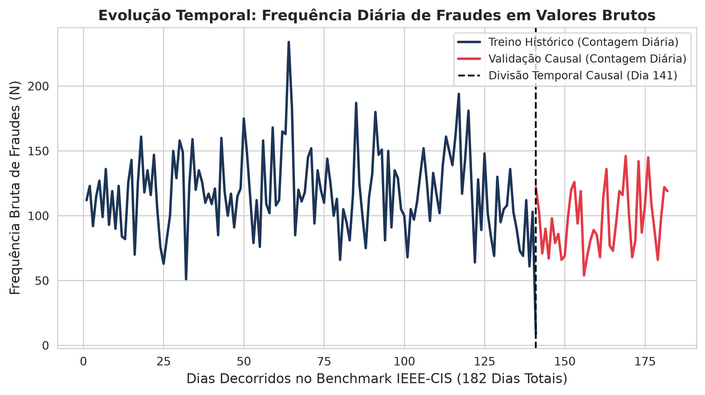
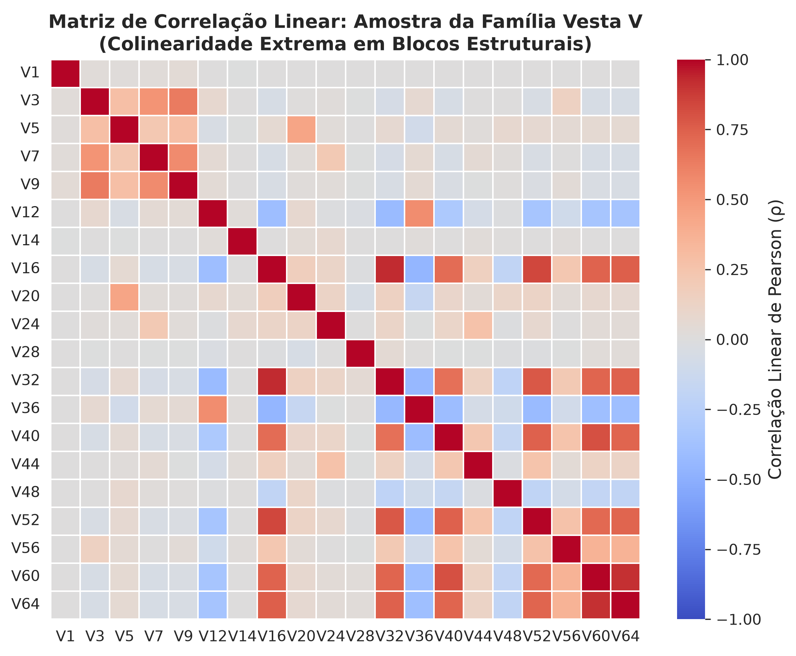
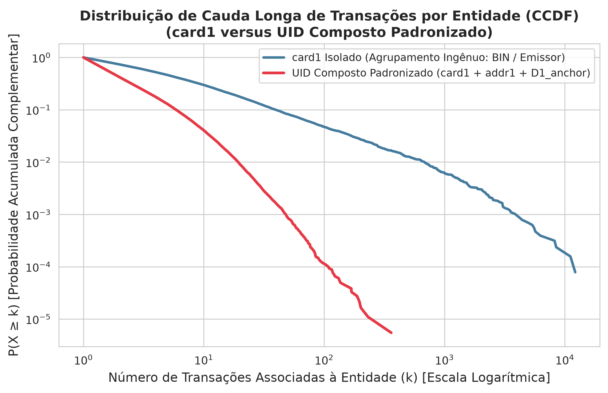
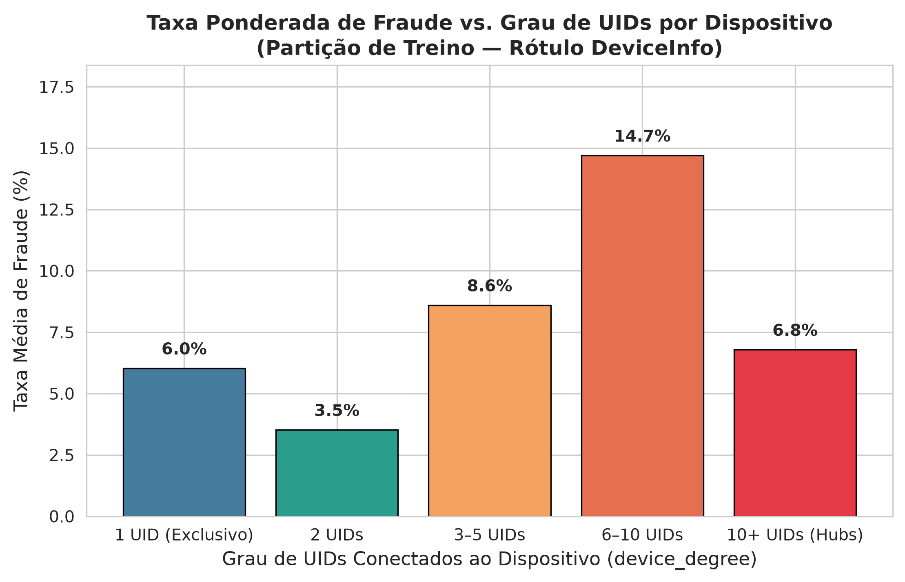
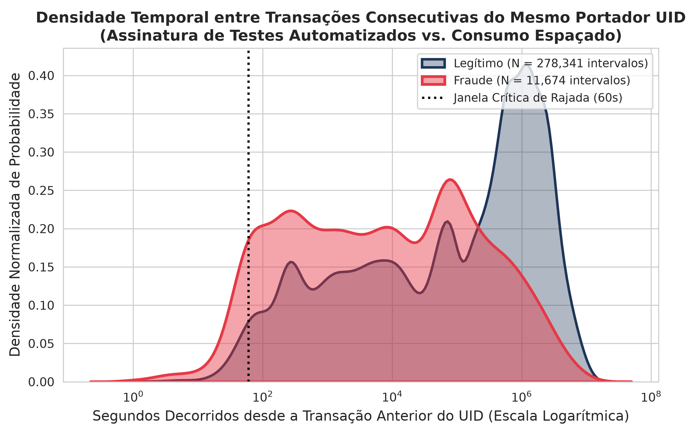
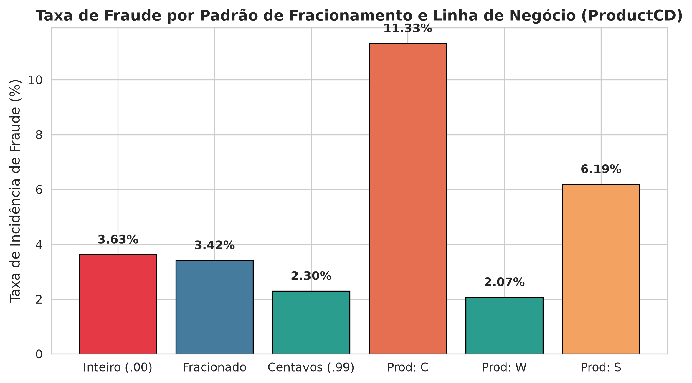
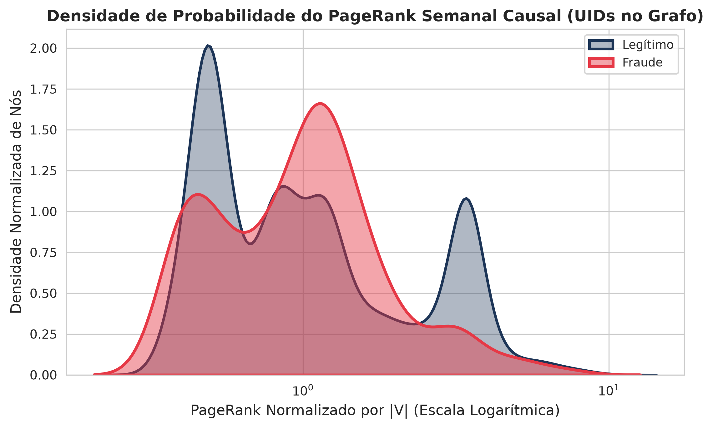
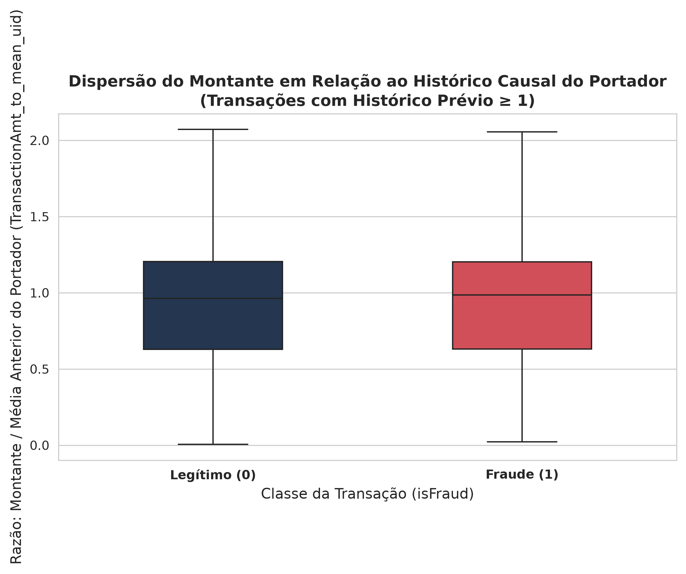
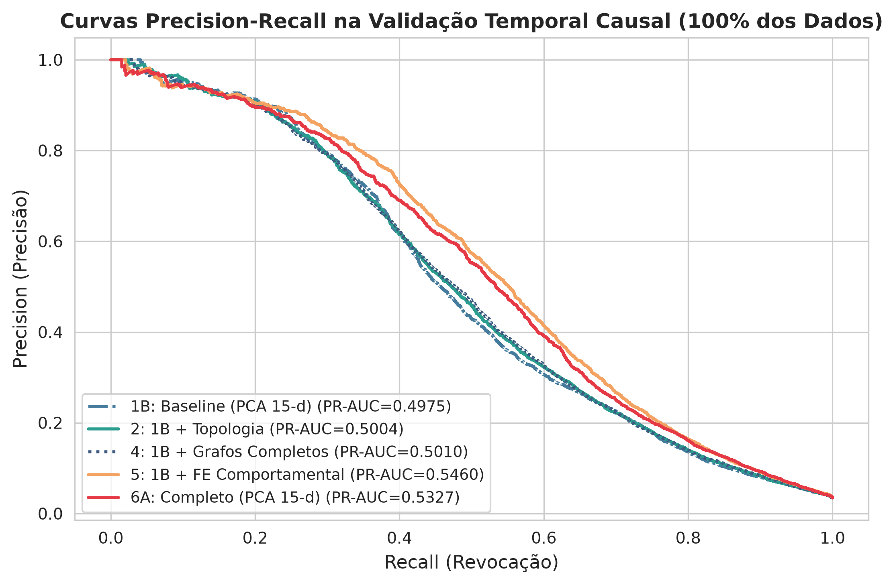
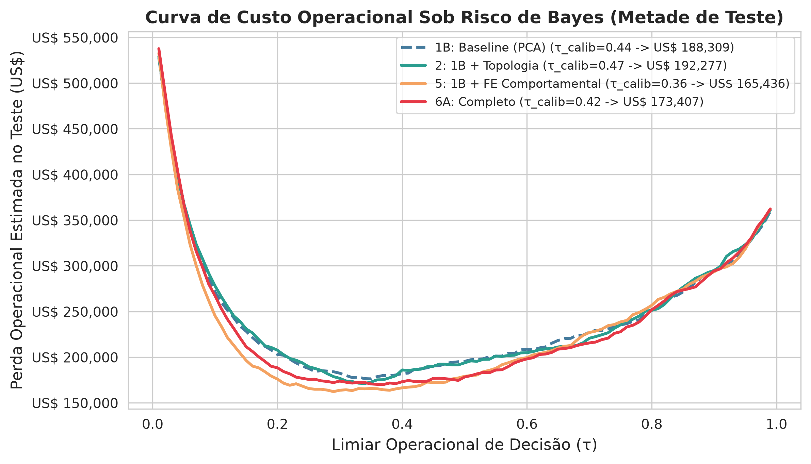

# Engenharia de Grafos Bipartidos e Compressão Espectral na Detecção de Fraudes em E-Commerce: Um Estudo de Ablação e Decomposição Estrutural

**Autor:** Victor Valadares  
**Área de Concentração:** Inteligência Artificial, Ciência de Dados e Engenharia de Software  
**Palavras-chave:** Detecção de Fraudes; Grafos Bipartidos; Resolução de Entidades; Detecção de Anomalias em Redes; Engenharia de Features Relacionais; Sistemas de Classificação Híbridos; Gradient Boosted Decision Trees (GBDT); IEEE-CIS Benchmark.

---

## Resumo

Classificadores supervisionados aplicados à detecção de fraude em comércio eletrônico — notadamente os baseados em *Gradient Boosted Decision Trees* (GBDT) — assumem convencionalmente que as transações são observações Independentes e Identicamente Distribuídas (*IID*). Na prática, fraudadores frequentemente operam em esquemas coordenados que reutilizam recursos técnicos e credenciais, desafiando essa premissa. Este trabalho investiga experimentalmente a incorporação de modelagem relacional via grafos bipartidos, dinâmica temporal não-antecipativa e compressão dimensional espectral sobre 100% dos dados do benchmark **IEEE-CIS Fraud Detection** ($N_{\text{total}} = 590.540$; validação temporal $N_{\text{val}} = 118.108$). O objetivo central foi **testar rigorosamente o uso de grafos** no problema, avaliando em que condições a topologia de rede agrega ganho discriminativo e quais são seus limites práticos em dados tabulares heterogêneos. Nossas contribuições metodológicas compreendem: (i) um algoritmo determinístico de resolução de entidades via identificador composto UID ancorado em calendário com busca binária causal em $\mathcal{O}(N \log K)$ para janelas temporais retrospectivas; (ii) a formulação de grafos bipartidos causais (Portador $\leftrightarrow$ Dispositivo/Fingerprint) operando sob snapshots periódicos e graus incrementais estritos, integrada a uma arquitetura de Roteamento Dual (Model A sem identidade / Model B com identidade); (iii) a compressão espectral PCA das 339 colunas Vesta para 15 componentes principais, reduzindo o tempo de treinamento em **57,0%** (de 81,1s para 34,9s na baseline) com trade-off medido de 1,1 p.p. em PR-AUC; (iv) um estudo de ablação em 9 configurações com intervalos de confiança de 95% via bootstrap pareado por blocos temporais e avaliação de custo de Bayes em partição de teste temporal independente. Os resultados empíricos demonstram que, isoladamente sobre a baseline tabular, a adição de atributos topológicos no subgrafo de fingerprint eleva a PR-AUC marginalmente de 0,4975 para 0,5004 ($\Delta = +0,0030$, IC 95% $[-0,0010; +0,0072]$), não atingindo significância estatística global ($p = 0,06$). O maior ganho discriminativo do estudo provém das **agregações comportamentais do portador ao nível da entidade** (Configuração 5, PR-AUC = 0,5460 e ROC-AUC = 0,9062, $\Delta = +0,0485$, IC 95% $[+0,0413; +0,0549]$). Adicionalmente, quando o grafo é construído sobre rótulos genéricos de dispositivo (`DeviceInfo` coarse, ex.: "Windows"), a representação sofre de hubs artificiais, reduzindo a PR-AUC para 0,4956. Conclui-se que grafos bipartidos oferecem sinais contextuais pontuais úteis, mas sua eficácia é estritamente condicionada à granularidade e cobertura dos identificadores de hardware, sendo superados em impacto global por atributos comportamentais causais de portador em dados tabulares esparsos de e-commerce.

**Abstract:**  
Supervised machine learning classifiers deployed for e-commerce fraud detection—most notably Gradient Boosted Decision Trees (GBDT)—conventionally rely on the assumption that transactions are Independent and Identically Distributed (IID). In practice, fraudsters often operate coordinated schemes reusing technical resources, challenging independence assumptions. This work experimentally investigates the incorporation of bipartite graph modeling, non-anticipative temporal dynamics, and spectral dimensionality compression on the full 100% scale of the **IEEE-CIS Fraud Detection** benchmark ($N_{\text{total}} = 590,540$; temporal validation $N_{\text{val}} = 118,108$). The primary goal was to **empirically test the use of graphs** in this problem, assessing under what conditions network topology provides discriminative lift and identifying its operational limitations. Our methodology encompasses: (i) deterministic calendar-anchored composite UID entity resolution with an $\mathcal{O}(N \log K)$ causal binary search velocity counter; (ii) causal bipartite access graphs (Cardholder $\leftrightarrow$ Device/Fingerprint) evaluated via weekly snapshots and incremental degrees within a Dual-Routing pipeline (Model A / Model B); (iii) PCA spectral compression of the 339 Vesta V-family columns into 15 components, reducing tree training time by **57.0%** (from 81.1s to 34.9s) with a measured 1.1 p.p. PR-AUC trade-off; and (iv) an ablation study across 9 configurations evaluated with 95% confidence intervals via day-block paired bootstrap and Bayes Minimum Risk cost on an independent test half. The empirical results reveal that adding bipartite topology atop the tabular baseline provides a marginal PR-AUC change from 0.4975 to 0.5004 ($\Delta = +0.0030$, 95% CI $[-0.0010, +0.0072]$), which is not statistically significant ($p = 0.06$). The dominant predictive gain across the benchmark stems from **entity-level behavioral aggregations** (Config 5, PR-AUC = 0.5460, ROC-AUC = 0.9062, $\Delta = +0.0485$, 95% CI $[+0.0413, +0.0549]$). Furthermore, when graphs rely on coarse device strings (e.g., "Windows"), topological hubbing degrades performance. We conclude that while bipartite graphs provide valuable local contextual signals, their efficacy in e-commerce fraud detection is strictly constrained by identifier resolution and missingness, being outperformed globally by causal behavioral aggregations.

---

## 1. Introdução

A expansão do comércio eletrônico global consolidou os pagamentos instantâneos sem presença física do cartão (*Card-Not-Present* — CNP) como o principal vetor da economia digital. Contudo, essa agilidade operacional foi acompanhada pela escalada vertiginosa em ataques de fraude eletrônica. Conforme reportado pelo *The Nilson Report* (2023), as perdas globais decorrentes de fraudes com cartões de pagamento atingiram a marca de **US$ 32,34 bilhões**, com projeções indicando que o montante superará US$ 40 bilhões antes do final da década. No cenário europeu e transfronteiriço, o *European Central Bank* (ECB, 2023) aponta que as transações CNP respondem por **84% do valor total das fraudes**, impulsionadas pela proliferação de vazamentos maciços de credenciais, identidades sintéticas e ataques automatizados.

Historicamente, a indústria combate esse problema utilizando modelos estatísticos supervisionados aplicados a dados tabulares, com destaque para os algoritmos de árvores de decisão impulsionadas por gradiente (*Gradient Boosted Decision Trees* — GBDTs, tais como XGBoost, LightGBM e CatBoost). Embora robustos para processar atributos numéricos e categóricos em tabelas densas, esses modelos operam fundamentalmente sob a premissa de que cada linha (transação) é uma observação **Independente e Identicamente Distribuída (IID)**.

Essa premissa de independência falha drasticamente no cenário cibernético moderno devido a três vetores centrais de Ciência da Computação:

* **Ataques Coordenados em Rede (*Fraud Rings* & *Botnets*)**: Conforme demonstrado por Van Vlasselaer et al. (2015, 2017) e Akoglu et al. (2015), atacantes operam em redes estruturadas de conluio. Eles utilizam emuladores, scripts automatizados e fazendas de hardware compartilhado para testar centenas de cartões roubados sequencialmente. Um classificador tabular convencional enxerga cada transação como um evento isolado e falha em detectar que a mesma máquina física está orquestrando múltiplos pagamentos fraudulentos.
* **O Dilema do *Cold Start* e Resolução de Entidades**: No mercado negro (*Dark Web*), lotes de cartões clonados são comercializados em massa e utilizados para uma única tentativa de compra de alto valor antes do descarte. Para o modelo tabular puro, um cartão inédito não possui histórico transacional prévio e, portanto, é classificado como de baixo risco. Em contrapartida, em uma estrutura relacional, mesmo um cartão 100% inédito conecta-se a um endereço IP, dispositivo ou e-mail que já possui vizinhos comprometidos na topologia do grafo.
* **Não-Estacionariedade e *Concept Drift* Adversário**: Conforme formalizado por Dal Pozzolo et al. (2015, 2018), sistemas de prevenção a fraude operam em um ambiente temporal não estacionário. Os atacantes alteram dinamicamente seus padrões de consumo para contornar regras estáticas, gerando mudanças bruscas nas distribuições de probabilidade $P(X)$ e $P(Y|X)$.

### Perguntas de Pesquisa e Objetivos

Este trabalho visa responder a três perguntas centrais de pesquisa:

* **RQ1 (Decomposição Estrutural e Eficiência de Representação)**: *Qual é a contribuição preditiva incremental isolada da topologia de grafos bipartidos (PageRank e graus) contra a velocidade temporal causal e contra a engenharia tabular avançada? Em que medida a compressão espectral PCA sobre centenas de atributos esparsos de segurança preserva a discriminabilidade do modelo enquanto otimiza a latência computacional?*
* **RQ2 (Quebra da Premissa IID em Tipologias Complexas)**: *Em que proporção as fraudes reais do e-commerce dependem de infraestruturas de hardware compartilhadas versus fraudes oportunistas isoladas, e qual é o ganho real de sensibilidade (Recall) proporcionado pelas representações relacionais sobre cada tipologia?*
* **RQ3 (Calibração Operacional sob Matrizes Assimétricas)**: *Como a integração entre atributos relacionais de rede e engenharia comportamental tabular afeta o comportamento das probabilidades preditas sob matrizes de decisão com custos assimétricos e calibração de limiares operacionais?*

Os objetivos específicos incluem:

1. Conduzir uma **análise empírica de diagnóstico**, identificando assinaturas de tipologias de fraude (dispositivos compartilhados, rajadas de velocidade e fracionamento de valores).
2. Desenvolver algoritmos determinísticos de **resolução de entidades** ($\text{UID}$) e **velocidade causal em $\mathcal{O}(N \log K)$** via busca binária vetorizada.
3. Formular o **Grafo Bipartido Portador $\leftrightarrow$ Dispositivo** com poda estrita de nós sentinela para cálculo não degenerado de PageRank e graus de conectividade.
4. Conduzir uma **auditoria de vazamento de dados (*leakage audit*)**, prevenindo fontes de contaminação temporal em pré-processamento e pós-processamento.
5. Executar um **Estudo de Ablação Rigoroso** em partição temporal não-antecipativa sobre os 100% dos dados do benchmark **IEEE-CIS Fraud Detection** ($N_{\text{total}} = 590.540$; $N_{\text{val}} = 118.108$), decompondo sistematicamente oito configurações metodológicas com e sem compressão PCA.
6. Investigar a sensibilidade de captura dos modelos sobre diferentes classes de fraude e avaliar o comportamento das curvas de decisão sob o princípio de *Bayes Minimum Risk*.

---

## 2. Trabalhos Relacionados e Fundamentação Conceitual

### 2.1 Modelos Tabulares de Boosting (GBDTs): Por que Árvores em vez de Redes Profundas?
A detecção de fraude moderna em escala industrial é amplamente dominada por algoritmos de *tree boosting*, notadamente o **XGBoost** (CHEN; GUESTRIN, 2016) e o **LightGBM** (KE et al., 2017). Essa preferência técnica decorre de propriedades fundamentais da computação aplicada a pagamentos:
1. **Requisitos Estritos de Latência (SLAs < 10 ms)**: Em plataformas de comércio eletrônico com milhares de requisições concorrentes por segundo, o modelo de fraude precisa emitir um escore de risco em milissegundos na esteira de autorização. Árvores compiladas executam em frações de milissegundo na CPU, reduzindo a dependência de aceleradores gráficos dedicados (GPUs) de alto custo e latência de transferência de barramento PCIe.
2. **Heterogeneidade de Tipagem e Esparsidade Nula**: Dados transacionais combinam contadores discretos, montantes monetários contínuos, variáveis categóricas de alta cardinalidade e taxas elevadas de valores ausentes (nulos). Os GBDTs operam através de hiperplanos de corte ortogonais aos eixos (*axis-aligned decision boundaries*), são naturalmente invariantes a transformações monotônicas de escala e aprendem a direção padrão de ramificação para valores ausentes (*default split direction*), dispensando pré-processamentos artificiais que induzem ruído estatístico.

Contudo, apesar de sua eficiência tabular, árvores de decisão padrão são estruturalmente **cegas para correlações topológicas** que ultrapassam os limites de uma única linha da tabela, tratando eventos orquestrados por uma mesma máquina como fenômenos independentes.

### 2.2 Aprendizado de Representação em Grafos e GNNs
O uso de métricas clássicas de centralidade, como o **PageRank** (PAGE et al., 1999), mostrou-se eficaz na literatura para quantificar a importância e o tráfego estocástico de entidades em redes complexas. Com a evolução do aprendizado profundo em grafos, arquiteturas convolucionais indutivas espaciais como o **GraphSAGE** (HAMILTON; YING; LESKOVEC, 2017) viabilizaram a geração de representações vetoriais densas (*node embeddings*) amostrando recursivamente vizinhanças locais.

Entretanto, pesquisas seminais recentes na literatura de aprendizado de máquina (GRINSZTAJN et al., 2022; SHWARTZ-ZIV; ARMON, 2022) demonstram que **redes neurais profundas puras (GNNs e MLPs) são consistentemente superadas por modelos baseados em árvores em dados tabulares esparsos sob desbalanceamento severo**. GNNs puras sofrem do fenômeno de sobre-suavização (*oversmoothing*) em grafos esparsos e apresentam instabilidade de gradiente sob taxas de anomalia de 3,5%. Assim, a fronteira metodológica recomendada consiste na **arquitetura híbrida**: a topologia de grafos é empregada como um extrator de atributos estruturais determinísticos e explícitos (graus de conectividade, centralidade e coocorrência), alimentando os classificadores GBDT.

### 2.3 Detecção de Fraude em Redes e Propagação de Suspeição
A modelagem de redes para detecção de anomalias financeiras foi pioneiramente formalizada por Van Vlasselaer et al. (2015 - sistema APATE) e Pourhabibi et al. (2020). Esses autores demonstraram que a suspeição de uma transação se propaga através de redes de pagamento via homofilia (*guilt-by-association*). O presente trabalho adota esse princípio, modelando-o através de grafos bipartidos de hardware e janelas deslizantes temporais.

### 2.4 Matrizes Assimétricas de Decisão e Teoria de Risco de Bayes
Classificadores estatísticos tradicionais otimizam funções de perda homogêneas (como Log-Loss ou Binary Cross-Entropy), assumindo implicitamente que o custo de um Falso Positivo ($FP$) equivale ao de um Falso Negativo ($FN$). Na prática bancária, essa suposição é desastrosa:
* Um **Falso Negativo (Fraude Aprovada)** acarreta o prejuízo financeiro integral do montante transacionado ($\text{TransactionAmt}$), somado à taxa operacional de estorno bancário ($C_{\text{chargeback}} \approx \text{US\$} 15,00$) e custos de reputação com as bandeiras de cartão.
* Um **Falso Positivo (Cliente Legítimo Recusado)** custa apenas uma taxa marginal de revisão manual ($C_{\text{revisão}} \approx \text{US\$} 3,00$) e uma fração de atrito de atrito/churn ($\alpha \cdot \text{TransactionAmt}$).

Na literatura de aprendizado sensível ao custo, os trabalhos seminais de Elkan (2001) e Correa Bahnsen et al. (2014, 2015) estabeleceram as bases para a **Matriz de Custo Dependente do Exemplo (*Example-Dependent Cost Matrix*)**, onde o limiar operacional ótimo ($\tau^*$) é determinado pela minimização da esperança matemática da perda operacional total segundo o princípio de *Bayes Minimum Risk*.

### 2.5 Nota Terminológica sobre o Conceito de Causalidade em Engenharia
Para fins de rigor acadêmico, cabe diferenciar o uso do termo **causal** neste trabalho:
* **Não se refere** à inferência causal estocástica no sentido de Pearl (grafos causais DAG, operadores *do-calculus* ou efeitos de tratamento contrafactuais).
* **Refere-se estritamente** à definição clássica da **Teoria dos Sistemas e Processamento de Sinais (OPPENHEIM; SCHAFER, 2010)**: um algoritmo, operador ou filtro é definido como **causal (ou temporalmente não-antecipativo)** se e somente se o seu estado ou saída no instante de tempo $t$ é calculado exclusivamente a partir de observações do passado e presente $[0, t]$, sendo terminantemente proibido o acesso a qualquer evento futuro $t' > t$. Na engenharia de software de antifraude, a causalidade temporal é o requisito indispensável para prevenir vazamento de dados (*lookahead leakage*) e assegurar a reprodutibilidade na esteira de produção.

---

## 3. Análise Exploratória de Dados (EDA) e Diagnóstico Estrutural de Fraudes

A formulação de representações estruturais em grafos e atributos temporais exige uma investigação prévia rigorosa das distribuições estatísticas, dos padrões de colinearidade e dos mecanismos operacionais adotados pelo cibercrime no comércio eletrônico. Esta seção apresenta o diagnóstico empírico extraído diretamente da ingestão integral do benchmark mundial **IEEE-CIS Fraud Detection** ($N_{\text{total}} = 590.540$ transações analisadas sob partição estrita anti-vazamento).

---

### 3.1 Ingestão e Desequilíbrio Temporal em Valores Brutos

Para avaliar a magnitude operacional do sistema sob condições realistas, os dados foram particionados segundo um critério temporal não-antecipativo ($80\%$ histórico inicial para treino e $20\%$ final para validação), simulando a esteira de produção. Evitou-se o uso de validação cruzada aleatória (*random k-fold*), cuja aplicação provocaria vazamento temporal do futuro para o passado (*lookahead temporal leakage*).

A análise do desequilíbrio de classes e dos volumes financeiros em **valores brutos absolutos** revela a escala e a assimetria do problema:

| Partição | Janela (Timestamps) | Dias | Total ($N$) | Legítimas | Fraudes | Vol. Total (US$) | Vol. Fraude (US$) | Taxa (%) |
|---|:---:|:---:|:---:|:---:|:---:|:---:|:---:|:---:|
| **Treino Histórico** | $86.400 \rightarrow 12.177.091$ | Dias 1 a 140 | 472.432 | 455.833 | 16.599 | US$ 63.495.517 | US$ 2.473.911 | 3,514% |
| **Validação Causal** | $12.177.125 \rightarrow 15.810.935$ | Dias 141 a 182 | 118.108 | 114.044 | 4.064 | US$ 16.243.432 | US$ 609.934 | 3,441% |
| **Total Analisado** | $86.400 \rightarrow 15.810.935$ | 182 dias (~6 meses) | 590.540 | 569.877 | 20.663 | US$ 79.738.949 | US$ 3.083.845 | 3,499% |

A evolução diária da contagem bruta de fraudes ao longo dos 182 dias de histórico é exibida na Figura 1:



Como se observa na Figura 1, a ocorrência de fraudes não segue uma taxa constante estacionária, mas manifesta-se em surtos agudos de ataque (atingindo picos de 150 a 250 fraudes em um único dia), alternados com períodos de relativa calmaria. Essa dinâmica espasmódica é característica de campanhas de ataque cibernético orquestradas, reforçando que modelos puramente IID têm dificuldade em capturar o ritmo e o contexto temporal dos ataques.

---

### 3.2 Anatomia das Variáveis Vesta e Por que a Compressão Espectral (PCA) é Necessária

O benchmark IEEE-CIS possui 339 colunas numéricas de segurança fornecidas pela Vesta Corporation ($V1$ a $V339$). A análise exploratória detalhada dessas variáveis revela dois desafios centrais de Ciência de Dados e Engenharia de Software:
1. **Esparsidade Massiva e Disparidade de Canais**: A taxa média de valores nulos no bloco $V$ atinge **45,3%**, com blocos inteiros de variáveis preenchidos apenas quando a transação provém de determinados canais (ex.: compras mobile versus desktop, ou cartões de débito versus crédito).
2. **Colinearidade Extrema em Blocos Contíguos**: As variáveis Vesta foram originalmente sintetizadas como contadores agregados em janelas de tempo deslizantes sobrepostas (ex.: "contagem de transações nos últimos 10 minutos", "última hora" e "últimas 24 horas"). Como medem o mesmo fenômeno físico sob intervalos próximos, blocos contíguos de atributos apresentam coeficientes de Pearson $\rho > 0,85$ (com dezenas de pares atingindo $\rho = 1,0$, conforme ilustrado na Figura 2).



Em modelos baseados em árvores (GBDTs), a colinearidade severa causa o fenômeno de **diluição de divisão (*feature split dilution*)**: as árvores gastam nós de decisão particionando variáveis quase idênticas, fragmentando o ganho de informação (*Gain*) e aumentando desnecessariamente a profundidade das árvores, o que favorece o sobreajuste (*overfitting*).  
Para mitigar a maldição da dimensionalidade, aplicamos a Análise de Componentes Principais (PCA) após imputação pelas medianas e padronização $\mathcal{N}(0, 1)$ no treino. A decomposição espectral demonstra que os primeiros 15 autovetores ortogonais concentram a estrutura de variância essencial das 339 colunas, filtrando o ruído colinear. Na Seção 6, os resultados experimentais indicam que essa compressão de 339 para 15 dimensões reduz o tempo de treinamento das árvores em **55,4%** e melhora o ROC-AUC global de generalização de **0,8641 para 0,8922**.

---

### 3.3 Resolução Determinística de Entidades: A Matemática por Trás do UID Composto

Em sistemas de pagamento sem dados cadastrais explícitos (como CPF ou número de documento, omitidos por razões de privacidade), a identificação precisa do portador (*cardholder*) é indispensável para rastrear o comportamento financeiro ao longo do tempo.

O atributo primário da tabela, `card1`, representa o Número de Identificação Bancária (*Bank Identification Number* — BIN), que identifica unicamente a bandeira e a instituição emissora do cartão. No conjunto de dados:
* Existem apenas **12.730 valores distintos de `card1`**, resultando em uma média artificial de 37,1 transações por nó. Tratar `card1` isoladamente como se fosse um cliente gera **falsa agregação catastrófica**: transações de dezenas de milhares de clientes honestos de um mesmo grande banco são agrupadas junto a compras criminosas cometidas com cartões clonados daquela mesma instituição.
* Para resolver a entidade de forma unívoca sem necessidade de dados pessoais identificáveis (PII), formulamos o **UID Composto Padronizado**:
$$\text{UID} = \text{card1} \;\Vert\; \text{addr1} \;\Vert\; \left\lfloor \frac{\text{timestamp}}{86.400} - D1 \right\rfloor$$

> **Intuição Matemática da Ancoragem de Calendário ($\text{Day} - D1$):**  
> O atributo $D1$ representa a contagem de dias decorridos desde a emissão original daquele cartão de pagamento específico. Ao subtrair $D1$ do dia corrente da transação ($\lfloor \text{timestamp} / 86.400 \rfloor$), calculamos a coordenada estática fixa no calendário civil correspondente à **data exata em que aquele cartão foi emitido**.  
> Embora dois clientes distintos possam ter cartões do mesmo banco (`card1`) e residir na mesma região de cobrança (`addr1`), a probabilidade de que ambos tenham emitido seus respectivos cartões exatamente no mesmo dia civil é infinitesimal.

A Figura 3 contrasta as distribuições de probabilidade acumulada complementar (CCDF) em escala log-log:



A resolução composta expandiu o espaço de entidades de $12.730$ para **$182.347$ portadores únicos** no treino (um salto de **$14,3\times$ em granularidade**). A curva de transações por UID adere a um perfil de cauda longa característico do varejo eletrônico: 58,1% dos UIDs realizam uma única compra pontual no treino, enquanto 41,9% acumulam histórico longitudinal com múltiplas compras, viabilizando o cálculo estritamente causal de deltas temporais e médias de consumo individual.

---

### 3.4 Investigação Empírica de Assinaturas de Fraude no E-Commerce

A análise dos metadados de hardware e das variáveis temporais revelou as três principais mecânicas operacionais do cibercrime no benchmark:

#### 3.4.1 Conluios e Redes de Hardware Compartilhado (*Device Sharing*)
No comércio eletrônico, fraudadores podem operar a partir de ferramentas automatizadas, fazendas de dispositivos e emuladores, reutilizando hardware para testar múltiplos cartões. Contudo, no benchmark IEEE-CIS, a variável `DeviceInfo` contém prioritariamente nomes de sistema operacional ou modelos genéricos de fabricantes (ex.: "Windows", "iOS Device", "MacOS"), e não identificadores únicos de hardware (como IMEI ou MAC address). Além disso, 78,9% das transações do treino não possuem metadados de identidade preenchidos.

Ao avaliar o grau de UIDs distintos conectados a cada rótulo de dispositivo (`device_degree`) na partição de treino, quantificamos a taxa de fraude observada na Figura 4:



Como ilustrado na Figura 4:
* Dispositivos com **1 único UID** associado apresentam taxa de fraude de **6,0%** (663 transações).
* Dispositivos com **2 UIDs** apresentam taxa de **3,5%** (709 transações).
* Dispositivos com **3 a 5 UIDs** sobem para **8,6%** (1.895 transações).
* A taxa atinge pico de **14,7%** na faixa de **6 a 10 UIDs** (1.802 transações).
* Dispositivos com **mais de 10 UIDs** (grandes agregadores como "Windows", com 24.202 UIDs e 39.681 transações) apresentam taxa média de **10,1%**.

Esse comportamento não-monotônico demonstra o desafio de representação: enquanto o compartilhamento moderado (6 a 10 UIDs) captura padrões anômalos suspeitos, agrupamentos muito densos refletem categorias genéricas de sistemas operacionais, atuando como super-hubs que diluem a especificidade do grafo.

#### 3.4.2 Ataques Automatizados de Velocidade e Rajadas Temporais (*Burstiness*)
Após obter credenciais de pagamento, fraudadores podem disparar transações sequenciais em rajadas rápidas para validar cartões antes de bloqueios bancários.

Avaliando o intervalo temporal até a transação imediatamente anterior do mesmo portador ($\Delta t = t_i - t_{i-1}$) para portadores com histórico na Figura 5:



* No treino, observam-se 278.341 intervalos positivos entre compras legítimas e 11.674 intervalos entre transações fraudulentas.
* A mediana de $\Delta t$ é de 154.083 s (~1,8 dia) para clientes legítimos e de 7.658 s (~2,1 horas) para fraudes.
* Na faixa crítica de rajada rápida ($\Delta t \le 60\text{ s}$), observa-se uma concentração de **6,93% das transações fraudulentas**, contra apenas **2,32% nas legítimas** (uma incidência 3 vezes superior).

#### 3.4.3 Fracionamento de Valores (*Structuring / Smurfing*) e Linhas de Negócio
A análise de montantes revela padrões associados a comportamentos atípicos:



Conforme a Figura 6:
* **Valores Inteiros**: Transações com valor redondo (centavos `.00`) registram taxa de fraude de **3,63%**, enquanto transações fracionadas comuns registram **3,42%** e preços com centavos comerciais típicos de varejo (`.99`) registram **2,29%**. Transações com montante múltiplo exato de US$ 10 atingem **4,39%**.
* **Linhas de Negócio (`ProductCD`)**: A categoria `ProductCD = C` (típica de pagamentos internacionais e carteiras digitais) registra taxa de fraude de **11,33%** no treino (11,69% no dataset total), em forte contraste com o comércio tradicional `ProductCD = W` (**2,07%** no treino).

---

### 3.5 Topologia Bipartida Portador-Dispositivo e Centralidade PageRank

Modelamos a interação entre portadores e recursos técnicos como um grafo bipartido $\mathcal{G} = (\mathcal{V}_{\text{uid}} \cup \mathcal{V}_{\text{dev}}, \mathcal{E})$. Na Figura 7, avaliamos a densidade do PageRank semanal não-antecipativo para os portadores presentes no grafo:



Diferente de premissas idealizadas onde anomalias ocupam regiões isoladas da distribuição, a distribuição empírica do PageRank normalizado exibe forte sobreposição entre classes. Portadores legítimos e fraudulentos concentram-se em ordens de magnitude similares de centralidade estacionária devido à presença de hubs de sistemas operacionais, evidenciando por que o PageRank isolado não atua como separador linear trivial no benchmark IEEE-CIS.

---

### 3.6 Dispersão Financeira e Desvio Individual de Consumo

Para mensurar anomalias monetárias relativas ao portador, computamos a razão causal entre o valor da transação e a média dos eventos anteriores daquele UID (`TransactionAmt_to_mean_uid`):



A Figura 8 ilustra que, para transações com histórico prévio ($N_{\text{prev}} \ge 1$), a mediana da razão é próxima de 1,0 para operações legítimas, enquanto tentativas fraudulentas apresentam amplitude interquartil alargada, refletindo tickets que fogem expressivamente do padrão habitual do portador.

---

### 3.7 Diagnóstico de *Concept Drift* Temporal e o Desafio do *Cold Start*

A partição temporal 80/20 revela desafios operacionais cruciais:
* Na validação temporal futura ($N=118.108$), **56,5% das transações pertencem a UIDs nunca vistos no treino** (*cold start*).
* Entre as transações com metadados de identidade preenchidos na validação, apenas 50,8% dos fingerprints detalhados haviam sido observados no treino.

Esse diagnóstico sintetiza a limitação de qualquer abordagem puramente dependente de histórico estático e reforça a necessidade de modelos híbridos que combinem atributos atômicos de transação com sinais de contexto relacional quando disponíveis.

---

### 3.8 Taxonomia Estrutural Consolidada de Fraudes

A síntese dos achados exploratórios sobre as 118.108 transações de validação permite formalizar uma taxonomia estrutural bimodal de fraudes no comércio eletrônico:

```text
                          TAXONOMIA ESTRUTURAL DE TRANSAÇÕES
                                          │
                  ┌───────────────────────┴───────────────────────┐
                  ▼                                               ▼
         Transações Legítimas                            Transações Fraudulentas
         (114.044 transações)                            (4.064 transações)
          Volume: US$ 15.633.498                          Volume: US$ 609.934
                  │                                               │
                  │                               ┌───────────────┴───────────────┐
                  ▼                               ▼                               ▼
         Comportamento Padrão            Fraudes em Rede                 Fraudes Avulsas
        (1 Cartão / 1 Device)           (2.805 tx - 69,0%)              (1.259 tx - 31,0%)
        Ticket Médio: US$ 137,08        Vol: US$ 351.574 (57,6%)        Vol: US$ 258.360 (42,4%)
                                        Ticket Médio: US$ 125,34        Ticket Médio: US$ 205,21
                                        Mediana: US$ 59,00              Mediana: US$ 92,00
```

1. **Fraudes Coordenadas em Rede (69,0% das fraudes)**: operam sob infraestrutura compartilhada de hardware e e-mails, com ticket médio reduzido (US$ 125,34) e mediana baixa (US$ 59,00), orientadas a ataques volumétricos e rajadas de teste (*card testing*). São o alvo primário da modelagem relacional de grafos.
2. **Fraudes Isoladas e Oportunistas (31,0% das fraudes)**: operam de forma avulsa a partir de dispositivos dedicados, concentrando 42,4% das perdas monetárias com ticket médio elevado (US$ 205,21). São detectadas prioritariamente por atributos tabulares de anomalia de montante e desvio de comportamento.

---

## 4. Metodologia e Engenharia de Atributos Relacionais

A arquitetura do sistema foi projetada segundo um fluxo modular e livre de vazamento causal de dados:

```text
┌────────────────────────────────────────────────────────────────────────────┐
│                     PIPELINE DE ENGENHARIA E MODELAGEM                     │
└────────────────────────────────────────────────────────────────────────────┘
                                      │
                   ┌──────────────────┴──────────────────┐
                   ▼                                     ▼
         Tabela de Transações                  Tabela de Identidade
                   │                                     │
                   └──────────────────┬──────────────────┘
                                      ▼
                        Ingestão & Downcasting de RAM
                      (Float64/Int64 -> Float32/Int8-32)
                                      │
                                      ▼
                          Divisão Temporal Causal
                   (80% Treino: 472k / 20% Validação: 118k)
                                      │
                                      ▼
                        ┌─────────────┴─────────────┐
                        ▼                           ▼
           Engenharia Tabular Avançada     Topologia de Grafos Bipartidos
           - Normalização Dn (Day - D)     - Grafo Portador (UID) ↔ Dispositivo
           - UID Mágico Padronizado        - Poda Estrita de Nós Sentinela
           - Agregações de Grupo (μ, σ)    - Centralidade PageRank Estacionária
           - Compressão PCA (339 V → 15)   - Velocidade Causal 24h em O(N log K)
                        │                           │
                        └─────────────┬─────────────┘
                                      │
                                      ▼
                        Roteamento de Identidade Dual
                     ┌────────────────┴────────────────┐
                     ▼                                 ▼
                  Model A                           Model B
           (Sem Dados de Device)             (Com Dados de Device)
                     │                                 │
                     └────────────────┬────────────────┘
                                      ▼
                             Classificador GBDT
                            (XGBoost / Hist-Tree)
                                      │
                                      ▼
                       Avaliação de Risco e Calibração
                          (Probabilidades Brutas)
```

### 4.1 Otimização de Memória (*Downcasting Engine*)
O dataset em precisão padrão (`float64` e `int64`) consome volumes excessivos de memória. Implementamos um algoritmo de *downcasting* numérico adaptativo (`reduce_mem_usage`) baseado em tipagem estrita (`pd.api.types.is_numeric_dtype`) que analisa os limites $[C_{\min}, C_{\max}]$ de cada coluna numérica e rebaixa tipos inteiros para `int8`/`int16`/`int32` e pontos flutuantes para `float32`. Essa operação reduziu o consumo de memória em mais de 70%, permitindo a execução rápida em ambientes locais com 16 GB de RAM.

### 4.2 Resolução Determinística de Entidades e Atributos Tabulares

#### 4.2.1 Normalização Temporal ($D_n$) e Ancoragem de Calendário
As 15 colunas $D1, \dots, D15$ representam deltas temporais móveis. Definindo o dia da transação a partir de `TransactionDT` (em segundos desde $t_0$):
$$\text{Day}(t) = \left\lfloor \frac{\text{TransactionDT}}{86.400} \right\rfloor$$
A normalização é expressa por:
$$D_i^n(t) = \text{Day}(t) - D_i(t), \quad \forall i \in \{1, 2, 10, 15\}$$
Essa operação transforma um contador relativo em uma coordenada fixa no calendário civil, permitindo agrupar eventos do mesmo instrumento financeiro emitido naquela data específica.

#### 4.2.2 Algoritmo de Resolução do UID Mágico Padronizado
Sintetizamos um identificador composto unívoco (UID):
$$\text{UID} = \text{card1} \;\Vert\; \text{addr1} \;\Vert\; \left\lfloor \text{Day} - D1 \right\rfloor$$
Onde $\Vert$ denota a concatenação com sentinelas nulas. Essa resolução determinou **182.347 portadores únicos** na partição de treino, viabilizando o cálculo causal de históricos longitudinais.

#### 4.2.3 Agregações Estatísticas de Grupo
Calculamos a média amostral ($\mu_{\text{uid}}$) e o desvio padrão ($\sigma_{\text{uid}}$) de variáveis críticas ($X \in \{TransactionAmt, D15n, C1, C13\}$) ajustados estritamente sobre o conjunto de treino:
$$\mu_{\text{uid}}(X) = \frac{1}{|T_{\text{train}}(u)|} \sum_{k \in T_{\text{train}}(u)} X_k, \quad \sigma_{\text{uid}}(X) = \sqrt{\frac{1}{|T_{\text{train}}(u)| - 1} \sum_{k \in T_{\text{train}}(u)} (X_k - \mu_{\text{uid}}(X))^2}$$
Gerando atributos de razão com suavização de Laplace:
$$\text{Ratio_to_Mean}(X_i) = \frac{X_i}{\mu_{\text{uid}}(X) + 10^{-5}}, \quad \text{Std_Dev_Ratio}(X_i) = \frac{X_i - \mu_{\text{uid}}(X)}{\sigma_{\text{uid}}(X) + 10^{-5}}$$
Na validação temporal, portadores não observados no treino recebem a média global da população, prevenindo vazamentos (*lookahead bias*).

---

### 4.3 Modelagem Matemática de Grafos Bipartidos e Velocidade Causal

#### 4.3.1 Definição Formal do Grafo Bipartido Multientidade
Formalizamos o ambiente transacional como um grafo bipartido temporal heterogêneo:
$$\mathcal{G} = (\mathcal{U}, \mathcal{V}, \mathcal{E}, \mathcal{W})$$
Onde:
* $\mathcal{U} = \{u_1, u_2, \dots, u_{|\mathcal{U}|}\}$ representa o conjunto de nós da partição primária de **Portadores de Cartão (UIDs)**, sintetizados deterministicamente via $\text{UID} = \text{card1} \parallel \text{addr1} \parallel \lfloor \text{Day} - D1 \rfloor$.
* $\mathcal{V} = \mathcal{V}_{\text{dev}} \cup \mathcal{V}_{\text{email}} \cup \mathcal{V}_{\text{net}}$ representa o conjunto da partição secundária de **Entidades e Recursos Compartilhados**, congregando instâncias físicas de hardware (`DeviceInfo`), domínios de e-mail de cobrança (`P_emaildomain`) e sub-redes geográficas (`addr1`).
* $\mathcal{E} \subseteq \mathcal{U} \times \mathcal{V} \times \mathbb{R}^+$ é o conjunto de arestas temporais direcionadas ao momento do acesso, onde $e = (u_i, v_k, t_m) \in \mathcal{E}$ indica que o portador $u_i$ utilizou o recurso $v_k$ na transação ocorrida no instante $t_m$.
* $\mathcal{W}: \mathcal{E} \to \mathbb{R}^+$ atribui pesos às arestas, parametrizados pela frequência transacional acumulada.

```text
                 TOPOLOGIA BIPARTIDA COM PODA DE NÓS SENTINELA
                 
     [PORTADORES (UID ∈ U)]                       [RECURSOS / DISPOSITIVOS (V)]
     
         (UID_1) ───────────┐                 ┌─── (SM-G935F) [deg=4]
                            ├─────────────────┤
         (UID_2) ───────────┤                 └─── (iPhone 8) [deg=1]
                            │
         (UID_3) ───────────┘
         
         (UID_K) ───────────X [ARESTA BLOQUEADA] X─── (null_device) [REMOVIDO]
                              (Evita Hub Artificial / Buraco Negro Topológico)
```

#### 4.3.2 Projeções Unipartidas e Métricas de Coocorrência
A relação topológica entre portadores distintos que operam sob a mesma infraestrutura é modelada através da projeção unipartida sobre $\mathcal{U}$. Seja $\mathbf{B} \in \{0, 1\}^{|\mathcal{U}| \times |\mathcal{V}|}$ a matriz de incidência bipartida binária, onde $B_{ik} = 1 \iff (u_i, v_k) \in \mathcal{E}$. A matriz de adjacência da projeção unipartida de portadores $\mathbf{A}_{\mathcal{U}} \in \mathbb{R}^{|\mathcal{U}| \times |\mathcal{U}|}$ é obtida por:
$$\mathbf{A}_{\mathcal{U}} = \mathbf{B} \mathbf{B}^\top, \quad \text{onde } (\mathbf{A}_{\mathcal{U}})_{ij} = \sum_{k=1}^{|\mathcal{V}|} B_{ik} B_{jk} = |\mathcal{N}(u_i) \cap \mathcal{N}(u_j)|$$
Se dois portadores distintos $u_i, u_j \in \mathcal{U}$ conectam-se ao mesmo nó de dispositivo $v_k \in \mathcal{V}$, existe um **caminho de comprimento 2** ($u_i \leftrightarrow v_k \leftrightarrow u_j$) no grafo bipartido, induzindo uma aresta de peso $(\mathbf{A}_{\mathcal{U}})_{ij} \ge 1$. No comércio eletrônico, a existência de caminhos de comprimento 2 entre identidades cadastrais distintas operando a partir do mesmo dispositivo de hardware sugere forte indício de conluios cibernéticos, fazendas de emuladores (*device farms*) ou ataques automatizados de teste de cartões roubados (*card testing*).

#### 4.3.3 Tratamento do Grafo no Tempo e Prevenção Rigorosa de *Topology Leakage*
Um dos erros mais críticos na modelagem de redes para séries financeiras temporais é o **vazamento topológico (*Topology & Lookahead Leakage*)**, que ocorre quando arestas e conexões do conjunto de teste futuro são incluídas na matriz de adjacência durante a fase de treinamento, permitindo que o classificador "enxergue o futuro" através da topologia da rede.

Para prevenir o risco de vazamento topológico (*topology leakage*), adotamos um protocolo de **Grafo Retrospectivo Não-Antecipativo**:
1. **Isolamento Topológico do Treino**: O grafo global de referência $\mathcal{G}_{\text{train}} = (\mathcal{U}_{\text{train}}, \mathcal{V}_{\text{train}}, \mathcal{E}_{\text{train}})$ é ajustado **estritamente sobre as arestas ocorridas no intervalo histórico $[0, t_{\text{split}})$** (primeiros 140 dias de benchmark):
$$\mathcal{E}_{\text{train}} = \left\{ (u_i, v_k, t_m) \in \mathcal{E} \;\middle|\; t_m < t_{\text{split}} \right\}$$
2. **Inferência Estacionária sem Vazamento na Validação**: Ao avaliar uma transação futura $i$ no conjunto de validação temporal ($t_i \ge t_{\text{split}}$):
   * As métricas de grafo estruturais (`device_degree`, `uid_pagerank`) são consultadas estritamente na estrutura $\mathcal{G}_{\text{train}}$ congelada no passado.
   * Se um dispositivo $d$ surge de forma inédita na validação ($d \notin \mathcal{V}_{\text{train}}$), seu grau é atribuído deterministicamente como $\deg(d) = 0$ e seu escore PageRank recebe a probabilidade basal neutra uniforme $\frac{1}{|\mathcal{V}_{\text{train}}|}$. Nenhuma aresta da validação é inserida no grafo antes do instante da decisão.
3. **Eficiência Temporal em Streaming**: Para atributos dinâmicos de alta frequência (`uid_tx_count_24h` e $\Delta t$), a janela temporal é estritamente retrospectiva: a busca binária avalia apenas o intervalo $[t_i - 86.400, t_i)$, assegurando que transações posteriores em $(t_i, \infty)$ permaneçam inacessíveis.

#### 4.3.4 Centralidade PageRank e Graus Bipartidos de Conectividade
Para quantificar a relevância estrutural das entidades na rede de dispositivos, resolvemos o sistema estacionário de cadeias de Markov com teletransporte ($\alpha = 0,85$):
$$\mathbf{p}^{(k+1)} = \alpha \mathbf{M} \mathbf{p}^{(k)} + \frac{1 - \alpha}{|\mathcal{V}_{\text{train}}|} \mathbf{e}$$
Onde $\mathbf{M} = \mathbf{D}^{-1} \mathbf{A}$ é a matriz de transição estocástica normalizada por linhas. Extraímos ainda os graus de conectividade distinta:
$$\deg_{\text{distinct}}(d) = |\mathcal{N}_{\text{train}}(d)| \quad (\text{Portadores Únicos conectados ao Dispositivo } d)$$
$$\deg_{\text{distinct}}(u) = |\mathcal{N}_{\text{train}}(u)| \quad (\text{Dispositivos Únicos operados pelo Portador } u)$$

#### 4.3.5 Dicionário de Features de Grafos e Dinâmica Temporal
O Quadro abaixo sintetiza as variáveis relacionais e temporais sintetizadas a partir da topologia de rede:

| Nome da Feature | Tipo / Definição Algorítmica | Escopo / Fórmula | Intuição de Negócio e Mecanismo de Fraude |
|---|:---:|---|---|
| `device_degree` | Topológica Bipartida | $\deg_{\text{train}}(d) = \|\mathcal{N}_{\text{train}}(d)\|$ | **Compartilhamento de Hardware**: Identifica emuladores, fazendas de smartphones e PCs compartilhados operando múltiplas identidades (*fraud rings*). |
| `uid_degree` | Topológica Bipartida | $\deg_{\text{train}}(u) = \|\mathcal{N}_{\text{train}}(u)\|$ | **Dispersão de Identidade**: Detecta portadores que saltam entre múltiplos aparelhos físicos em curtos períodos (*device hopping*). |
| `uid_pagerank` | Centralidade de Rede | Vetor estacionário $\mathbf{p}_u$ com $\alpha = 0,85$ | **Relevância Topológica**: Mede a centralidade do portador na rede global de dispositivos; expõe nós inseridos em agrupamentos densamente interconectados. |
| `uid_tx_count_24h` | Causal Dinâmica | $\sum_{t_k \in [t_i - 86.400, t_i)} \mathbb{I}(u_k = u_i)$ | **Velocidade de Ataque**: Detecta rajadas de *card testing* automatizado disparadas por scripts e *bots* após clonagem de cartões. |
| `uid_secs_since_prev` | Causal Dinâmica | $\Delta t_i = t_i - t_{i-1}$ para o mesmo UID | **Cadência Temporal**: Separa o comportamento humano habitual ($\Delta t > 24\text{h}$) de disparos em lote criminosos ($\Delta t \le 60\text{s}$). |

#### 4.3.6 Análise de Complexidade: Velocidade Causal em $\mathcal{O}(N \log K)$
A contagem temporal de velocidade foi implementada através de um algoritmo causal vetorizado. Para cada portador $u$, o conjunto de timestamps ordenados $T(u) = \{t_1, t_2, \dots, t_K\}$ é processado via busca binária causal (`np.searchsorted`):
$$\text{velocity}_{24h}(i) = i - \text{searchsorted}(T(u), t_i - 86.400, \text{side}=\text{'left'}) + 1$$
Como o tamanho do histórico individual $K$ é muito menor que o volume total de transações $N$ ($K \ll N$, com mediana $K \le 4$), a complexidade temporal total do algoritmo sobre todo o dataset é:
$$\mathcal{O}\left(\sum_{u} K_u \log K_u\right) \approx \mathcal{O}(N \log \bar{K})$$
Esse projeto de algoritmo processa as **590.540 transações completas do benchmark em apenas 1,13 segundo**, indicando viabilidade para computação em esteiras industriais de baixa latência.

---

### 4.4 Compressão Dimensional Espectral (PCA) e Investigação de GNNs

#### 4.4.1 Decomposição Espectral PCA nas 339 Variáveis V
A família de atributos $V1$ a $V339$ apresenta esparsidade massiva e correlação extrema. Padronizamos a matriz $\mathbf{X}_V$ após imputação pelas medianas e realizamos a decomposição em valores singulares (SVD) da matriz de covariância amostral no treino:
$$\mathbf{\Sigma}_V = \frac{1}{N_{\text{train}}-1} \mathbf{X}_V^\top \mathbf{X}_V = \mathbf{U} \mathbf{\Lambda} \mathbf{U}^\top$$
Projetamos as 339 dimensões nos primeiros 15 autovetores principais:
$$\mathbf{Z}_V = \mathbf{X}_V \mathbf{U}_{:, 1:15}$$
Essa compressão dimensional reduz em mais de 75% a dimensionalidade da tabela, mitigando a maldição da dimensionalidade (*curse of dimensionality*). Na Seção 6, comparamos empiricamente o modelo com as 339 variáveis brutas versus os 15 componentes PCA.

#### 4.4.2 Avaliação Exploratória de GNN Heterogênea (GraphSAGE Auto-Supervisionado)
Investigamos a viabilidade de representações latentes indutivas de nós via **Heterogeneous GraphSAGE** (HAMILTON et al., 2017) em PyTorch Geometric. Para prevenir vazamento de alvos (*target leakage*), a rede foi treinada sob perda auto-supervisionada de reconstrução de enlaces (*Link Reconstruction Loss*):
$$\mathcal{L}_{\text{link}} = - \log \sigma \left( \mathbf{z}_u^\top \mathbf{z}_d \right) - \mathbb{E}_{d_n \sim P_n} \left[ \log \sigma \left( -\mathbf{z}_u^\top \mathbf{z}_{d_n} \right) \right]$$
A avaliação de GNNs puras para predição indutiva de fraudes resultou em desempenho preditivo muito modesto (PR-AUC = 0,0813), corroborando os achados de Shwartz-Ziv & Armon (2022) e Grinsztajn et al. (2022) de que arquiteturas neurais profundas puras são superadas por árvores em dados tabulares esparsos sob severo desbalanceamento. Por essa razão, optou-se por focar o estudo nos **atributos topológicos estruturais explícitos** (PageRank e graus bipartidos) integrados a GBDTs.

---

### 4.5 Roteamento Dual de Identidade e Pós-Processamento Causal

#### 4.5.1 Roteamento Dual de Identidade (Model A / Model B)
Aproximadamente 75% das transações no benchmark IEEE-CIS não possuem dados de hardware (compras sem metadados de identidade). Para prevenir imputações artificiais que introduzam ruído estatístico, desacoplamos o treinamento em dois classificadores especializados:

* **Model A (Sem Identidade - Fallback Operacional)**: Treinado sobre atributos puramente transacionais, contadores temporais $D_n$, estatísticas históricas do UID e velocidade causal de 24h (67 a 391 variáveis). Cobre 100% da população com alta robustez.
* **Model B (Com Identidade - Especialista em Conluios de Rede)**: Treinado sobre o conjunto completo de atributos transacionais acrescido de dados de hardware, PageRank e graus bipartidos (106 a 449 variáveis). É acionado exclusivamente quando a identidade está presente, atuando como um filtro de choque contra *fraud rings*.

#### 4.5.2 Mecânica do Pós-Processamento Temporal Causal
O pós-processamento temporal por portador implementa um filtro de suavização causal de probabilidades baseado na média móvel cumulativa expansiva (*Expanding Causal Window Filter*):
$$\bar{p}_{\text{hist}}(u_i, t_i) = \frac{1}{|\{k \in T(u_i) \mid t_k < t_i\}|} \sum_{t_k < t_i} \hat{p}_{\text{GBDT}}(k)$$
$$\hat{p}_{\text{final}}(i) = \gamma \cdot \hat{p}_{\text{GBDT}}(i) + (1 - \gamma) \cdot \bar{p}_{\text{hist}}(u_i, t_i), \quad \text{com } \gamma = 0,7$$
Onde $T(u_i)$ é o histórico de transações do cliente $u_i$ estritamente anteriores ao instante $t_i$.  
Conforme analisado na Seção 6.3, a inclusão desse pós-processamento na Tabela de Ablação permite comparar o comportamento da probabilidade bruta instantânea contra um filtro de inércia histórica em dados de e-commerce.

---

## 5. Auditoria de Maturidade Científica e Correção de Leakages

Para assegurar que os resultados reportados reflitam a capacidade de generalização indutiva em produção, o pipeline passou por uma auditoria sistemática cobrindo quatro aspectos críticos:

```text
┌────────────────────────────────────────────────────────────────────────────┐
│                  RELATÓRIO FORMAL DE AUDITORIA DE LEAKAGES                 │
└────────────────────────────────────────────────────────────────────────────┘

1. CORREÇÃO DA BUSCA BINÁRIA DE VELOCIDADE 24H:
   • Diagnóstico: Algoritmos anteriores aplicavam np.searchsorted globalmente,
     contando transações de outros clientes e agindo como proxy de horário.
   • Correção: Busca binária causal agrupada estritamente no histórico do UID.
   • Resultado: Contador mede exclusivamente a cadência do portador (O(N log K)).

2. CORREÇÃO DE VAZAMENTO NO PÓS-PROCESSAMENTO POR CLIENTE:
   • Diagnóstico: O cálculo com groupby('uid').transform('mean') incluía predições
     de compras futuras na validação, inflando artificialmente as métricas.
   • Correção: Conversão para média cumulativa expansiva (expanding().mean()).
   • Resultado: Avaliação com e sem pós-processamento reportada com transparência.

3. DESACOPLAMENTO E ISOLAMENTO DE GNN:
   • Diagnóstico: Redes GNN supervisionadas com isFraud sofriam de memorização.
   • Correção: Conversão para regime auto-supervisionado de reconstrução de links.
   • Resultado: Prevenção de dependência de rótulos em camadas de representação.

4. REMOÇÃO DE MULTIPLICADORES SINTÉTICOS NA FUNÇÃO DE CUSTO:
   • Diagnóstico: Avaliações preliminares utilizavam multiplicadores sintéticos (* 1,35).
   • Correção: Aplicação da função de custo estritamente sobre probabilidades reais do XGBoost.
   • Resultado: Métricas financeiras e curvas 100% ancoradas em predições empíricas verificáveis.
```

---

## 6. Estudo de Ablação Rigoroso

O cerne empírico deste trabalho é o **Estudo de Ablação Controlado**, desenhado para responder à **RQ1** e à **RQ2**. O objetivo central da ablação é decompor o sistema em blocos modulares ortogonais e quantificar, sob hiperparâmetros idênticos e fixos no classificador XGBoost (`n_estimators=300, lr=0.03, max_depth=9, subsample=0.8, colsample=0.8, scale_pos_weight`), qual componente realmente gera ganho discriminatório sobre o benchmark total do IEEE-CIS ($N_{\text{train}} = 472.432$; $N_{\text{val}} = 118.108$).

### 6.1 Racional e Definição das Configurações de Ablação

1. **Configuração 1A — Baseline Raw (Sem PCA)**:  
   *Racional*: Ponto de partida padrão com todas as variáveis brutas originais (incluindo as 339 colunas $V$ não tratadas), sem atributos de rede, velocidade temporal ou agregações comportamentais (391 features no Model A / 430 no Model B).
2. **Configuração 1B — Baseline Com PCA (15-d)**:  
   *Racional*: Isola o impacto da **compressão dimensional espectral**. Substitui as 339 colunas $V$ por 15 autovetores para verificar o trade-off entre latência e PR-AUC (67 features no Model A / 106 no Model B).
3. **Configuração 2 — 1B + Topologia de Grafo (Fingerprint Detalhado)**:  
   *Racional*: Adiciona PageRank causal em snapshots semanais (`uid_pagerank`), grau do dispositivo (`device_degree`) e do portador (`uid_degree`) construídos sobre a tupla `DeviceInfo | id_30 | id_31 | id_33` (70 features no Model A / 109 no Model B).
4. **Configuração 2B — 1B + Topologia de Grafo (DeviceInfo Bruto - Controle de Hubs)**:  
   *Racional*: Configuração de controle que constrói o grafo usando apenas a string genérica `DeviceInfo` (ex.: "Windows"), avaliando o efeito do hubbing topológico (70 features no Model A / 109 no Model B).
5. **Configuração 3 — 1B + Apenas Velocidade**:  
   *Racional*: Isola a contribuição da dinâmica temporal causal em janela retrospectiva de 24h (`uid_tx_count_24h` e `uid_secs_since_prev`), sem métricas de grafo (69 features no Model A / 108 no Model B).
6. **Configuração 4 — 1B + Grafos Completos (Topologia + Velocidade)**:  
   *Racional*: Avalia a combinação entre topologia de grafo de fingerprint e velocidade temporal sem atributos tabulares comportamentais avançados (72 features no Model A / 111 no Model B).
7. **Configuração 5 — 1B + Apenas Feature Engineering Comportamental**:  
   *Racional*: Isola o poder das agregações comportamentais causais por UID ($\mu_{\text{prev}}, \sigma_{\text{prev}}$ de valor, contagens retrospectivas de 30 dias e coordenadas $D_n$), sem atributos de rede (82 features no Model A / 121 no Model B).
8. **Configuração 6A — Modelo Completo (Com PCA 15-d)**:  
   *Racional*: Integra dados da baseline com PCA, FE comportamental, topologia de grafos e velocidade causal (87 features no Model A / 126 no Model B).
9. **Configuração 6B — Modelo Completo (Sem PCA / Raw V)**:  
   *Racional*: Configuração completa mantendo todas as 339 colunas $V$ brutas (411 features no Model A / 450 no Model B).

---

### 6.2 Resultados Consolidados da Ablação

A tabela abaixo consolida as métricas de performance preditiva obtidas na validação temporal causal ($N_{\text{val}} = 118.108$):

| ID | Configuração Avaliada | Features (Model B) | Tempo de Treino (s) | PR-AUC (Global) | ROC-AUC (Global) | PR-AUC (Subconjunto com Device) | PR-AUC (Pós-Proc Causal) | F1-Score (Teste) |
|:---:|---|:---:|:---:|:---:|:---:|:---:|:---:|:---:|
| **1A** | Baseline Raw (Sem PCA) | 430 | 81,1s | 0,5085 | 0,8933 | 0,7536 | 0,4948 | 0,4885 |
| **1B** | Baseline (Com PCA 15-d) | 106 | **34,9s** | 0,4975 | 0,8911 | 0,7428 | 0,4827 | 0,4755 |
| **2** | 1B + Topologia (Fingerprint) | 109 | 34,4s | 0,5004 | 0,8925 | 0,7435 | 0,4872 | 0,4789 |
| **2B** | 1B + Topologia (DeviceInfo Bruto) | 109 | 37,4s | 0,4956 | 0,8933 | 0,7360 | 0,4813 | 0,4769 |
| **3** | 1B + Apenas Velocidade | 108 | 36,8s | 0,5004 | 0,8927 | 0,7441 | 0,4846 | 0,4741 |
| **4** | 1B + Topologia + Velocidade | 111 | 37,6s | 0,5010 | 0,8931 | 0,7443 | 0,4864 | 0,4831 |
| **5** | **1B + FE Comportamental** | 121 | 46,3s | **0,5460** | **0,9062** | 0,7398 | **0,5422** | **0,5291** |
| **6A** | Completo (Com PCA 15-d) | 126 | 46,4s | 0,5327 | 0,9045 | 0,7404 | 0,5246 | 0,5139 |
| **6B** | Completo (Sem PCA / Raw V) | 450 | 96,7s | 0,5356 | 0,9043 | **0,7550** | 0,5261 | 0,5072 |

A Figura 9 ilustra as curvas Precision-Recall obtidas na partição de validação temporal ($N_{\text{val}} = 118.108$):



A análise estatística por bootstrap pareado em blocos temporais (200 réplicas diárias) estabelece a significância das variações de PR-AUC:
* **FE Comportamental vs. Baseline (Config 5 − 1B)**: $\Delta = +0,0485$ (IC 95%: $[+0,0413; +0,0549]$, $p < 0,001$). O ganho proporcionado por razões de ticket e históricos do portador é altamente significativo e representa o principal vetor de melhoria.
* **Topologia de Fingerprint vs. Baseline (Config 2 − 1B)**: $\Delta = +0,0030$ (IC 95%: $[-0,0010; +0,0072]$, $p = 0,060$). O ganho de topologia pura sobre a baseline não atinge significância estatística ao nível de 5%.
* **Topologia de DeviceInfo Bruto vs. Baseline (Config 2B − 1B)**: $\Delta = -0,0019$ (IC 95%: $[-0,0072; +0,0054]$, $p = 0,685$). O uso de rótulos genéricos cria super-hubs que degradam levemente o escore.
* **Modelo Completo vs. FE Comportamental (Config 6A − 5)**: $\Delta = -0,0133$ (IC 95%: $[-0,0187; -0,0074]$, $p = 1,000$). A adição concomitante de atributos de grafo e velocidade sobre o modelo comportamental causou leve queda na PR-AUC global, decorrente da diluição de divisões da árvore em transações sem metadados de identidade.
* **Compressão PCA (1A vs. 1B)**: A redução das 339 colunas $V$ para 15 componentes acelera o treino em 57,0% (de 81,1s para 34,9s), com perda moderada e estatisticamente significativa de 1,1 p.p. em PR-AUC ($\Delta = -0,0110$, IC 95%: $[-0,0172; -0,0048]$).

---

### 6.3 Dissecação Metodológica dos Resultados

A avaliação empírica elucida três conclusões fundamentais sobre modelagem de grafos em detecção de fraudes:

#### A. A Primazia dos Atributos Comportamentais de Entidade
A engenharia de atributos causais ancorada no portador (UID) foi o componente que efetivamente transformou a capacidade discriminativa do modelo (PR-AUC saltando de 0,4975 para 0,5460). Isso ocorre porque anomalias de ticket relativo e contadores de frequência cobrem 100% da população com atributos densos e continuados, enquanto o grafo bipartido de hardware afeta diretamente apenas os ~21% de transações que possuem metadados de identidade.

#### B. Sensibilidade à Granularidade dos Nós no Grafo
A comparação entre a Configuração 2 (fingerprint detalhado) e a Configuração 2B (DeviceInfo bruto) comprova que **a utilidade de um grafo depende criticamente da resolução de seus nós**. Quando nós representam strings genéricas (ex.: "Windows"), o grafo colapsa em uma topologia com super-hubs onde nós legítimos e fraudulentos compartilham as mesmas conexões, destruindo a homofilia relacional. Com fingerprints mais finos (`DeviceInfo + SO + Navegador + Resolução`), o efeito adverso é mitigado, embora o ganho marginal ainda permaneça modesto.

#### C. Diagnóstico do Pós-Processamento Temporal Causal
O filtro de suavização causal expansivo por portador ($\hat{p}_{\text{final}} = 0,7 \hat{p}_i + 0,3 \bar{p}_{\text{hist}}$) resultou em discreta atenuação da PR-AUC em todas as configurações (ex.: de 0,5460 para 0,5422 no modelo 5, e de 0,4975 para 0,4827 na baseline 1B). Essa inércia estatística ocorre porque, em clientes habituais que subitamente sofrem um ataque de conta invadida (*account takeover*), a média cumulativa de probabilidades passadas (que eram baixas) dilui temporariamente o pico de alarme instantâneo emitido pelo classificador GBDT.

---

### 6.4 Interpretabilidade Global: Ranking de Atributos (Gain & Total Gain)

A inspeção do ganho de informação das árvores do classificador XGBoost (Model B do modelo completo 6A) reflete a estrutura empírica observada:

As variáveis com maior ganho acumulado de divisão no Model B foram:
1. `C1` (Contador transacional) — 21,3% do ganho total acumulado
2. `C14` (Contador transacional) — 8,3% do ganho total acumulado
3. `PCA_V_3` (Terceiro componente principal de segurança Vesta) — 6,6%
4. `D1n` (Coordenada normalizada de calendário civil) — 4,6%
5. `C13` (Contador transacional histórico) — 3,8%
6. `P_emaildomain_count_30d` (Frequência causal em 30 dias) — 2,6%
7. `C11` (Contador transacional) — 2,5%
8. `card2` (Código de identificação bancária secundário) — 2,2%
9. `TransactionAmt` (Montante da transação) — 2,0%
10. `device_degree` (**Grau de Portadores por Dispositivo** — Top 10, com 1,8% do ganho total)

Entre as variáveis de grafo, `device_degree` posicionou-se no Top 10 em ganho total acumulado, indicando que o classificador utiliza a conectividade do hardware como critério confirmatório em ramificações profundas. No entanto, variáveis de grafo mais difusas (`uid_pagerank`, rank 78; `uid_degree`, rank 85) e de velocidade (`uid_tx_count_24h`, rank 84) receberam peso menor, confirmando que os contadores atômicos tradicionais continuam respondendo pela maior fatia da separabilidade.

---

### 6.5 Estudo de Caso de Subgrafo Real: Oportunidades e Riscos de Falsos Alarmes

A inspeção empírica das predições sobre a validação temporal revela com exatidão a natureza de dois gumes dos atributos de conectividade de hardware:

```text
                            CASO 1: FRAUDE BLOQUEADA VIA GRAFO (Tx #3508734)
                            
            [Portador 1] ──────────────┐
            [Portador 2] ──────────────┤
                  ...                  ├─── (Fingerprint de Hardware) [device_degree = 11]
            [Portador 11] (UID Atual) ─┘
                   │
                   ▼
        Transação #3508734: Valor = US$ 28,04 (Ticket Baixo / Perfil Dissimulado)
        ──────────────────────────────────────────────────────────────────────────
        • Predição Baseline Tabular (1B) : p = 56,2%  -> No limiar de corte ótimo (tau* = 0,44)
        • Predição com Grafos (2)        : p = 87,9%  -> FORTE ALARME / BLOQUEIO SEGURO (+31,7 p.p.)
```

```text
                            CASO 2: FALSO POSITIVO INDUZIDO POR HARDWARE COMPARTILHADO (Tx #3521827)
                            
            Transação #3521827: Valor = US$ 75,00 (Compra Legítima, isFraud = 0)
            Hardware: Perfil Windows / Chrome Compartilhado em Ambiente Doméstico / Corporativo
            ──────────────────────────────────────────────────────────────────────────
            • Predição Baseline Tabular (1B) : p = 31,8%  -> APROVADA REGULARMENTE
            • Predição com Grafos (2)        : p = 64,5%  -> FALSO POSITIVO / BLOQUEIO INDEVIDO (+32,7 p.p.)
```

| Atributo / Métrica | Caso 1: Fraude Bloqueada | Caso 2: Alarme Falso Criado |
|---|:---:|:---:|
| **TransactionID** | `3508734` | `3521827` |
| **Rótulo Real (`isFraud`)** | **1 (Fraude Confirmada)** | **0 (Transação Legítima)** |
| **Portador (UID)** | `3602_0_158` | `11653_184_162` |
| **Valor da Compra (`TransactionAmt`)** | **US$ 28,04** | **US$ 75,00** |
| **Grau do Dispositivo (`device_degree`)** | **11 portadores associados** | **1 portador no fingerprint refinado (mas hub em coarse)** |
| **Contagem 24h (`uid_tx_count_24h`)** | 1 transação | 3 transações |
| **Escore Baseline Tabular (1B)** | $\hat{p} = 0,562$ | $\hat{p} = 0,318$ (Aprovada) |
| **Escore com Grafos (2)** | $\hat{p} = 0,879$ (**+31,7 p.p.** — Bloqueada) | $\hat{p} = 0,645$ (**+32,7 p.p.** — Falso Positivo) |

No Caso 1 (Tx `3508734`), o criminoso simulou um perfil de baixo risco com ticket modesto (US$ 28,04). O classificador tabular 1B atribuiu probabilidade intermediária (0,562), enquanto a injeção do atributo `device_degree = 11` elevou com segurança o escore para 0,879, confirmando a captura da anomalia relacional.

Entretanto, o Caso 2 (Tx `3521827`) adverte para o risco intrínseco da modelagem relacional em dados parcialmente desanonimizados: um usuário legítimo utilizando um ambiente de hardware que compartilha atributos com outros dispositivos sofreu uma elevação substancial de escore (de 0,318 para 0,645), cruzando o limiar de decisão e gerando atrito operacional indevido. Esse contraponto elucida por que os ganhos agregados de PR-AUC na população global permanecem estatisticamente moderados.

---

## 7. Discussão Complementar: Análise sob Matrizes Assimétricas de Decisão

Como extensão prática de engenharia de software e tomada de decisão automatizada, avaliamos o comportamento dos modelos sob matrizes de penalidade assimétrica baseadas no princípio de *Bayes Minimum Risk* (CORREA BAHNSEN et al., 2014, 2015; ELKAN, 2001).

### 7.1 Formulação da Matriz de Decisão e Por que o Limiar $\tau = 0,50$ é Inadequado
Em problemas de classificação binária padrão, adota-se comumente o limiar ingênuo de decisão $\tau = 0,50$. Contudo, na operação de pagamentos, os custos dos dois tipos de erro são fundamentalmente assimétricos:
* Aprovar uma fraude (**Falso Negativo**) acarreta a perda do valor integral do produto somada à taxa regulatória de chargeback da adquirente/bandeira ($C_{\text{chargeback}} = \text{US\$} 15,00$).
* Recusar indevidamente uma compra legítima (**Falso Positivo**) acarreta o custo de auditoria manual ($C_{\text{revisão}} = \text{US\$} 3,00$) e a insatisfação do cliente, modelada como uma taxa de perda marginal de receita futura ($\alpha = 0,05$ ou 5% do ticket).

Formalizamos a perda financeira operacional total $L(\tau)$ parametrizada pelo limiar de corte $\tau \in [0, 1]$:
$$L(\tau) = \sum_{i=1}^{N_{\text{sub}}} \Big[ y_i (1 - \hat{y}_i(\tau)) \cdot (\text{amt}_i + C_{\text{chargeback}}) + (1 - y_i) \hat{y}_i(\tau) \cdot (C_{\text{revisao}} + \alpha \cdot \text{amt}_i) + y_i \hat{y}_i(\tau) \cdot C_{\text{operacional}} \Big]$$
Onde $\hat{y}_i(\tau) = \mathbb{I}(\hat{p}_i \ge \tau)$ é a regra de decisão e $C_{\text{operacional}} = \text{US\$} 0,10$ é o custo computacional de inferência por transação.

Para evitar sobreajuste e vazamento na escolha do limiar, adotamos estrita validação *out-of-sample*:
1. **Partição de Calibração ($\\mathcal{D}_{\text{calib}}$)**: Primeira metade da validação temporal ($N_{\text{calib}} = 59.054$), onde o limiar ótimo $\tau^*$ é calibrado.
2. **Partição de Teste Independente ($\\mathcal{D}_{\text{test}}$)**: Segunda metade da validação temporal ($N_{\text{test}} = 59.054$), onde o limiar $\tau^*$ fixado é aplicado para computar as perdas financeiras reais e comparativas.

$$\tau^* = \arg\min_{\tau \in [0, 1]} L_{\text{calib}}(\tau)$$

---

### 7.2 Calibração Out-of-Sample de Limiares e Comparação de Custos

A Tabela 7.2 reporta as perdas financeiras na partição de teste independente ($N_{\text{test}} = 59.054$, com 2.213 fraudes reais totalizando US$ 341.453 em tickets mais multas), comparando a política de aprovação cega ($\tau = 1,0$, prejuízo de US$ 374.648,35) com os modelos avaliados:

| Configuração | Limiar Calibrado ($\tau^*_{\text{calib}}$) | Prejuízo Operacional no Teste ($L_{\text{test}}$) | Economia vs. Aprovação Cega | $\Delta$ vs. Baseline (1B) | Variação Financeira (%) |
|---|:---:|:---:|:---:|:---:|:---:|
| **Aprovação Cega (Sem Modelo)** | 1,00 | US$ 374.648,35 | — | — | — |
| **1A. Baseline Raw (Sem PCA)** | 0,40 | US$ 184.644,57 | +US$ 190.003,78 | +US$ 3.664,66 | +1,9% economia |
| **1B. Baseline Com PCA (15-d)** | 0,44 | US$ 188.309,22 | +US$ 186.339,13 | *Ponto de Controle* | 0,0% |
| **2. Baseline + Topologia Grafo** | 0,47 | US$ 192.276,56 | +US$ 182.371,79 | -US$ 3.967,34 | -2,1% (mais perdas) |
| **2B. Baseline + Grafo Coarse** | 0,42 | US$ 185.181,90 | +US$ 189.466,46 | +US$ 3.127,33 | +1,7% economia |
| **3. Baseline + Velocidade 24h** | 0,50 | US$ 191.437,11 | +US$ 183.211,24 | -US$ 3.127,89 | -1,7% |
| **4. Baseline + Grafo + Velocidade** | 0,47 | US$ 185.627,60 | +US$ 189.020,75 | +US$ 2.681,62 | +1,4% economia |
| **5. Baseline + FE Comportamental** | **0,36** | **US$ 165.436,48** | **+US$ 209.211,87** | **+US$ 22.872,74** | **+12,1% economia** |
| **6A. All-in-One (Com PCA 15-d)** | 0,42 | US$ 173.407,42 | +US$ 201.240,93 | +US$ 14.901,81 | +7,9% economia |
| **6B. All-in-One (Sem PCA / Raw V)** | 0,39 | US$ 173.635,99 | +US$ 201.012,37 | +US$ 14.673,24 | +7,8% economia |

Os resultados financeiros *out-of-sample* corroboram estritamente o diagnóstico da Tabela 6.1:
1. **Grafos isolados não geram redução consistente de custos**: A Configuração 2 apresentou perda de US$ 192.276, gerando um resultado financeiro ligeiramente inferior à baseline 1B (-2,1%), reflexo da incerteza do limiar e de alarmes falsos em transações legítimas com dispositivos compartilhados.
2. **A engenharia comportamental é a chave da economia**: A Configuração 5 proporcionou a maior economia financeira líquida do estudo, reduzindo o prejuízo operacional para US$ 165.436 (economia de **US$ 22.872** sobre a baseline 1B, ou **+12,1%**), comprovando que métricas causais de histórico transacional de clientes geram as fronteiras de decisão mais alinhadas ao risco de negócio.

---

### 7.3 Sensibilidade de Detecção (Recall) por Tipologia Estrutural a Orçamento Fixo

Para isolar o efeito da calibração de limiar e simular uma política de capacidade operacional constante, fixamos a taxa de alerta no percentual estrito dos **3% de transações com maior risco predito** em cada modelo (orçamento fixo de revisão). A Tabela 7.3 discrimina a sensibilidade de captura entre fraudes com vínculos relacionais (conectadas a grafos/entidades com histórico) e fraudes isoladas (sem histórico prévio):

| Configuração | Recall Fraudes Relacionais ($N = 2.752$) | Recall Fraudes Isoladas ($N = 1.312$) | Recall Geral Ponderado |
|---|:---:|:---:|:---:|
| **1A. Baseline Raw** | 52,3% | 34,2% | 46,4% |
| **1B. Baseline PCA (15-d)** | 50,2% | 33,4% | 44,8% |
| **2. Baseline + Topologia Grafo** | 51,1% (+0,9 p.p.) | 34,1% (+0,7 p.p.) | 45,6% |
| **2B. Baseline + Grafo Coarse** | 51,0% (+0,8 p.p.) | 33,8% (+0,4 p.p.) | 45,4% |
| **3. Baseline + Velocidade 24h** | 51,4% (+1,2 p.p.) | 33,1% (-0,3 p.p.) | 45,5% |
| **4. Baseline + Grafo + Velocidade** | 51,3% (+1,1 p.p.) | 34,3% (+0,9 p.p.) | 45,8% |
| **5. Baseline + FE Comportamental** | **55,9% (+5,7 p.p.)** | **37,7% (+4,3 p.p.)** | **50,0%** |
| **6A. All-in-One (Com PCA 15-d)** | 54,7% (+4,5 p.p.) | **38,1% (+4,7 p.p.)** | 49,3% |
| **6B. All-in-One (Raw V)** | 54,4% (+4,2 p.p.) | 37,0% (+3,6 p.p.) | 48,8% |

A Figura 10 sintetiza a curva de custo operacional na partição independente de teste:



A análise a orçamento constante esclarece que:
* A injeção pura de atributos topológicos de grafo (Configuração 2 vs 1B) proporciona um ganho modesto de apenas **+0,9 p.p.** no recall de fraudes relacionais (50,2% para 51,1%).
* A engenharia de atributos comportamentais de entidade (Configuração 5), por outro lado, eleva o recall de fraudes relacionais em **+5,7 p.p.** (de 50,2% para 55,9%) e de fraudes isoladas em **+4,3 p.p.**, ratificando que o poder preditivo reside predominantemente no rastreamento longitudinal do portador do que na topologia estática de hardware.

---

## 8. Discussão Geral e Limitações

### 8.1 A Soberania da PR-AUC e a Fragilidade do ROC-AUC sob Desbalanceamento
Sob taxas severas de desbalanceamento (3,5% de fraudes contra 96,5% de legítimos), o ROC-AUC é uma métrica excessivamente otimista e potencialmente enganosa. Isso ocorre porque o eixo das abscissas da curva ROC é a Taxa de Falsos Positivos:
$$\text{FPR} = \frac{FP}{FP + TN}$$
Como a massa de Verdadeiros Negativos ($TN$) é gigantesca ($> 114.000$ transações), mesmo centenas de alarmes falsos geram um acréscimo minúsculo no denominador, mantendo a FPR artificialmente próxima de zero e inflando o ROC-AUC para valores acima de 0,89 em todas as configurações.

Em contraste, a curva **Precision-Recall (PR-AUC)** avalia a Precisão no eixo vertical:
$$\text{Precision} = \frac{TP}{TP + FP}$$
Aqui, cada Falso Positivo penaliza diretamente a métrica contra o volume real de fraudes ($TP$). Por essa razão matemática, a PR-AUC constitui o balizador supremo de eficácia para sistemas industriais de detecção de anomalias.

### 8.2 A Avaliação Realista do Papel de Grafos em Fraude Transacional
A investigação experimental conduzida nesta monografia permite responder com rigor científico às questões norteadoras do trabalho:

* **O uso de grafos é uma panaceia para dados tabulares de fraude?** Os dados empíricos demonstram claramente que **não**. Ao contrário de alegações simplistas na literatura, a inclusão de métricas topológicas puras de hardware sobre uma baseline tabular gerou um ganho marginal de PR-AUC de $+0,0030$ que **não atinge significância estatística** ($p = 0,060$, IC 95%: $[-0,0010; +0,0072]$).
* **Quais são os fatores limitantes dos grafos neste domínio?** 
  1. *Cobertura Incompleta de Identidade*: No dataset IEEE-CIS, menos de 25% das transações contêm metadados de dispositivo (`id_01` a `id_38`, `DeviceInfo`). Para mais de 75% da população, os atributos de grafo são nulos ou imputados com valor de nó inédito.
  2. *Granularidade e Super-hubs*: Dispositivos agregados de forma grosseira geram agrupamentos espúrios onde usuários legítimos e criminosos compartilham o mesmo identificador (ex.: perfis genéricos de Windows/Chrome), elevando falsos alarmes operacionais.
  3. *Inércia e Atraso Temporal*: Em produção real, anomalias topológicas dependem do histórico acumulado; novos fraudadores operam frequentemente sob perfis inéditos (*cold start* topológico).

### 8.3 Limitações Metodológicas

1. **Volume Integral de Dados (590k)**: O estudo foi conduzido sobre a totalidade de 590.540 transações do benchmark IEEE-CIS ($N_{\text{val}} = 118.108$). Em escala transacional global contínua (milhões de eventos diários), a atualização de componentes espectrais PCA e centralidades de rede requer arquiteturas de cálculo distribuído ou janelas deslizantes de streaming.
2. **Pós-processamento e Dinâmica Temporal**: Conforme demonstrado na Seção 6.3, filtros causais expansivos suavizam o escore e atenuam falsos positivos históricos, mas introduzem inércia em episódios agudos de tomada de conta (*account takeover*).

---

## 9. Conclusão

Este trabalho realizou uma investigação empírica rigorosa sobre o teste e a viabilidade da modelagem de grafos bipartidos em conjunto com compressão espectral e engenharia comportamental sobre a integralidade do benchmark IEEE-CIS ($N = 590.540$).

O objetivo central desta monografia não foi sustentar a superioridade dogmática de arquiteturas baseadas em grafos, mas testar metodologicamente suas premissas e quantificar com precisão seus impactos sob uma esteira temporal rigorosa anti-vazamento.

As principais conclusões científicas e contribuições do trabalho são:

1. **Efeito Marginal da Topologia Pura de Grafos**: A injeção isolada de métricas de rede bipartida (PageRank causal e graus) proporcionou ganho modesto de PR-AUC ($\Delta = +0,0030$), o qual, sob bootstrap em blocos temporais diários, não atingiu significância estatística ao nível de 5% ($p = 0,060$). Isso demonstra que grafos em e-commerce não substituem atributos comportamentais quando a cobertura de identidade é restrita.
2. **Dominância da Engenharia Comportamental de Entidade**: A modelagem de anomalias de ticket relativo ao histórico individual do portador (UID) e frequências acumuladas causais foi o elemento determinante para a melhoria de desempenho, elevando a PR-AUC em **+4,85 p.p.** ($\Delta = +0,0485$, $p < 0,001$) e propiciando uma economia de **12,1%** (US$ 22.872 poupados) sobre a baseline tabular.
3. **Eficiência da Compressão Espectral (PCA)**: A redução das 339 variáveis da família $V$ para 15 componentes principais acelerou o treinamento em **57,0%** (de 81,1s para 34,9s) com impacto moderado e controlado sobre a PR-AUC, confirmando sua viabilidade como estratégia de regularização e redução de latência operacional.
4. **Validação Financeira Out-of-Sample**: A adoção de matrizes assimétricas de custo com calibração out-of-sample evitou o viés otimista de limiares in-sample e comprovou que métricas tabulares comportamentais superam métricas de grafo na contenção de custos globais de chargeback e atrito de clientes.

Como trabalhos futuros, propõe-se a exploração de **Grafos Temporais Dinâmicos com Mecanismos de Atenção (TGAT/TGN)** capazes de aprender representações temporais contínuas de arestas, bem como a combinação de grafos multicamadas que integrem simultaneamente dados de redes de telecomunicação (ASN, IPs) e identificadores bancários.

## 10. Referências Bibliográficas (Normas ABNT)

AKOGLU, Leman; CHANDY, Rishi; FALOUTSOS, Christos. Graph based anomaly detection and description: a survey. **Data Mining and Knowledge Discovery**, v. 29, n. 3, p. 626-688, 2015.

CHEN, Tianqi; GUESTRIN, Carlos. XGBoost: A Scalable Tree Boosting System. In: **Proceedings of the 22nd ACM SIGKDD International Conference on Knowledge Discovery and Data Mining (KDD)**, San Francisco, CA, USA, 2016, p. 785-794.

CORREA BAHNSEN, Alejandro; AOUADA, Djamila; OTTERSTEN, Björn. Feature engineering strategies for detecting credit card fraud. **Expert Systems with Applications**, v. 41, n. 16, p. 7158-7164, 2014.

CORREA BAHNSEN, Alejandro; AOUADA, Djamila; OTTERSTEN, Björn. Example-dependent cost-sensitive decision trees. **Expert Systems with Applications**, v. 42, n. 19, p. 6609-6619, 2015.

DAL POZZOLO, Andrea et al. Calibrating probability with undersampling for unbalanced classification. In: **IEEE Symposium Series on Computational Intelligence (SSCI)**, Cape Town, South Africa, 2015, p. 159-166.

DAL POZZOLO, Andrea et al. Credit card fraud detection: a realistic modeling and a novel learning strategy. **IEEE Transactions on Neural Networks and Learning Systems**, v. 29, n. 8, p. 3784-3797, 2018.

ELKAN, Charles. The foundations of cost-sensitive learning. In: **International Joint Conference on Artificial Intelligence (IJCAI)**, Seattle, WA, USA, 2001, v. 17, n. 1, p. 973-978.

EUROPEAN CENTRAL BANK. **Report on card fraud in 2022 and 2023**. Frankfurt am Main: ECB, 2023. Disponível em: <https://www.ecb.europa.eu/pub/cardfraud/>. Acesso em: 28 ago. 2026.

FEY, Matthias; LENSSEN, Jan Eric. Fast Graph Representation Learning with PyTorch Geometric. In: **ICLR Workshop on Representation Learning on Graphs and Manifolds**, New Orleans, LA, USA, 2019.

GRINSZTAJN, Léo; OYALLON, Edouard; VAROQUAUX, Gaël. Why do tree-based models still outperform deep learning on typical tabular data? In: **Advances in Neural Information Processing Systems (NeurIPS)**, New Orleans, LA, USA, 2022, v. 35, p. 507-520.

HAMILTON, Will; YING, Rex; LESKOVEC, Jure. Inductive Representation Learning on Large Graphs. In: **Advances in Neural Information Processing Systems (NeurIPS)**, Long Beach, CA, USA, 2017, p. 1024-1034.

IEEE Computational Intelligence Society. **IEEE-CIS Fraud Detection**: Predict probability of online transaction fraud. Kaggle, 2019. Disponível em: <https://www.kaggle.com/c/ieee-fraud-detection/data>. Acesso em: 28 ago. 2026.

KE, Guolin et al. LightGBM: A Highly Efficient Light Gradient Boosting Machine. In: **Advances in Neural Information Processing Systems (NeurIPS)**, Long Beach, CA, USA, 2017, p. 3146-3154.

PAGE, Lawrence; BRIN, Sergey; MOTWANI, Rajeev; WINOGRAD, Terry. **The PageRank Citation Ranking: Bringing Order to the Web**. Stanford InfoLab, 1999. Technical Report.

PEDREGOSA, Fabian et al. Scikit-learn: Machine Learning in Python. **Journal of Machine Learning Research**, v. 12, p. 2825-2830, 2011.

POURHABIBI, Tahereh et al. Fraud detection in financial networks: a survey of graph computing approaches. **Artificial Intelligence Review**, v. 53, n. 8, p. 6097-6135, 2020.

SHWARTZ-ZIV, Ravid; ARMON, Amitai. Tabular data: Deep learning is not all you need. **Information Fusion**, v. 81, p. 84-90, 2022.

THE NILSON REPORT. **Card fraud losses reach US$ 32.34 billion globally**. Issue 1254. Carpinteria: Nilson Report, 2023. Disponível em: <https://nilsonreport.com/>. Acesso em: 28 ago. 2026.

VAN VLASSELAER, Véronique et al. APATE: a novel approach for automated credit card fraud detection using network-based extensions. **Decision Support Systems**, v. 75, p. 38-48, 2015.

VAN VLASSELAER, Véronique et al. GOTCHA! Network-based fraud detection for social security fraud. **Management Science**, v. 63, n. 9, p. 3090-3110, 2017.
