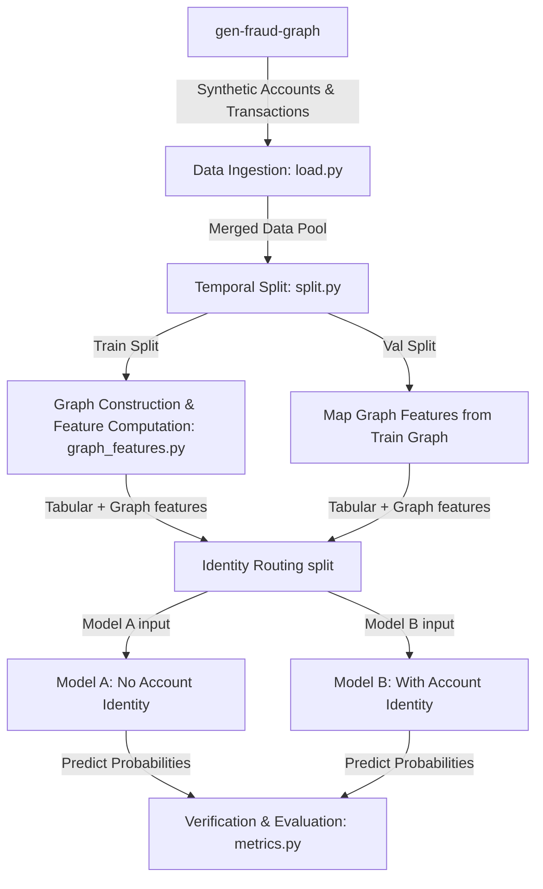

# TG-graph — Synthetic Fraud Graph ML Pipeline

A project dedicated to improving traditional machine learning systems for real-time fraud detection by enriching them with graph-structured features. This project leverages Santander's `gen-fraud-graph` to generate synthetic transaction logs, constructs bipartite graphs using NetworkX to derive structural network features, and trains XGBoost/LightGBM classifiers with optional GNN embeddings.

---

## How It Works



### 1. Data Generation (`src/data/generate_data.py`)
Uses Santander's `gen-fraud-graph` library to programmatically generate account nodes and transaction edges. We set the embedding dimension to 2 for fake text embeddings to prevent costly array serialization.

### 2. Features Engineering (`src/features/graph_features.py`)
Constructs a directed transaction network from the training split and calculates:
- **Node Degree (In/Out)**: The volume of incoming and outgoing transaction relations.
- **PageRank Centrality**: Evaluates the global structural importance of accounts in the transaction flow.
- **Neighborhood Fraud Rate**: The historical fraction of fraud transactions that touch the node.

To ensure **no data leakage**, all graph metrics are fitted on the training split transaction graph and mapped onto both splits. Unseen nodes in the validation set receive default values.

### 3. Model Training (`main.py`)
Splits the transactions into train and validation sets, partitions them into Group A (even account IDs) and Group B (odd account IDs) to simulate identity-routing sub-models, trains XGBoost/LightGBM classifiers, and runs the validation verification suite.

### 4. GNN Embeddings (`src/features/gnn_features.py`)
Computes Node2Vec/GraphSAGE embeddings on the transaction graph to capture higher-order structural patterns. These embeddings can be used as additional features (`--features augmented_gnn`) or as a standalone GNN model (`--model gnn`).

---

## Installation & Setup

1. Install dependencies and the generator in editable mode:
   ```bash
   uv pip install -e ./gen-fraud-graph
   ```
2. Generate the synthetic transactions:
   ```bash
   uv run python src/data/generate_data.py --scale 0.01 --output data/raw
   ```

---

## Pipeline Usage

### Run Tabular Baseline Model
Train XGBoost models using only account and transaction attributes (amount, balance, risk score):
```bash
uv run python main.py --features tabular
```

### Run Graph-Augmented Model
Train XGBoost models augmented with NetworkX graph-structured features (PageRank, degree, fraud rate):
```bash
uv run python main.py --features augmented
```

### Run GNN-Augmented Model
Train LightGBM/XGBoost models augmented with GNN embeddings (Node2Vec/GraphSAGE):
```bash
uv run python main.py --features augmented_gnn --model lgbm
```

### Run Pure GNN Model (IEEE-CIS dataset)
Train a standalone Graph Neural Network on the transaction graph:
```bash
uv run python main.py --model gnn --dataset ieee
```

### Use Synthetic Dataset with Different Hardness Levels
```bash
uv run python main.py --dataset synthetic --hardness low
uv run python main.py --dataset synthetic --hardness medium
uv run python main.py --dataset synthetic --hardness high
```

### Use IEEE-CIS Real-World Dataset
```bash
uv run python main.py --dataset ieee --sample 0.1
```

---

## Command Line Arguments

| Argument | Options | Default | Description |
|----------|---------|---------|-------------|
| `--model` | `xgb`, `lgbm`, `gnn` | `xgb` | Classifier algorithm |
| `--features` | `tabular`, `augmented`, `augmented_gnn` | `tabular` | Feature set to use |
| `--dataset` | `synthetic`, `ieee` | `synthetic` | Dataset to load |
| `--hardness` | `low`, `medium`, `high` | `low` | Synthetic data difficulty |
| `--seed` | integer | `42` | Random seed |
| `--sample` | float (0-1) | None | Data fraction for testing |

---

## Jupyter Notebooks

We provide two Jupyter Notebooks in the `notebooks/` directory to help analyze the data and experiment interactively:

1. **[01_eda_and_feature_selection.ipynb](file:///home/victor/Documents/TG-graph/notebooks/01_eda_and_feature_selection.ipynb)**: Performs Exploratory Data Analysis on the synthetic accounts and transactions, computes class imbalance, visualizes distributions, and saves the initial feature lists.
2. **[02_model_and_verification.ipynb](file:///home/victor/Documents/TG-graph/notebooks/02_model_and_verification.ipynb)**: Implements the baseline GBDT model training step-by-step, performs identity routing, runs the verification suite, plots Precision-Recall curves, and computes SHAP value importances.

To run the notebooks:
```bash
uv run jupyter notebook
```

---

## Project Structure

```
TG-graph/
├── src/
│   ├── data/           # Data download and generation
│   ├── features/       # Feature engineering (tabular, graph, GNN)
│   ├── models/         # Model training (baseline XGB/LGBM)
│   └── evaluation/     # Metrics and verification suite
├── gen-fraud-graph/    # Submodule: Santander synthetic data generator
├── notebooks/          # Jupyter notebooks for EDA and modeling
├── scripts/            # Utility scripts (Kaggle setup, notebook adaptation)
├── docs/adr/           # Architecture Decision Records
├── main.py             # CLI entry point
├── pyproject.toml      # Project configuration
└── README.md           # This file
```

---

## Evaluation

Primary metric: **PR-AUC** (Precision-Recall Area Under Curve) due to highly imbalanced fraud data.

The verification suite (`src/evaluation/metrics.py`) reports:
- Overall PR-AUC and ROC-AUC
- Per-group metrics (Group A: no identity, Group B: with identity)
- Temporal stability checks
- Calibration plots

---

## License

MIT License - see [LICENSE](LICENSE) for details.